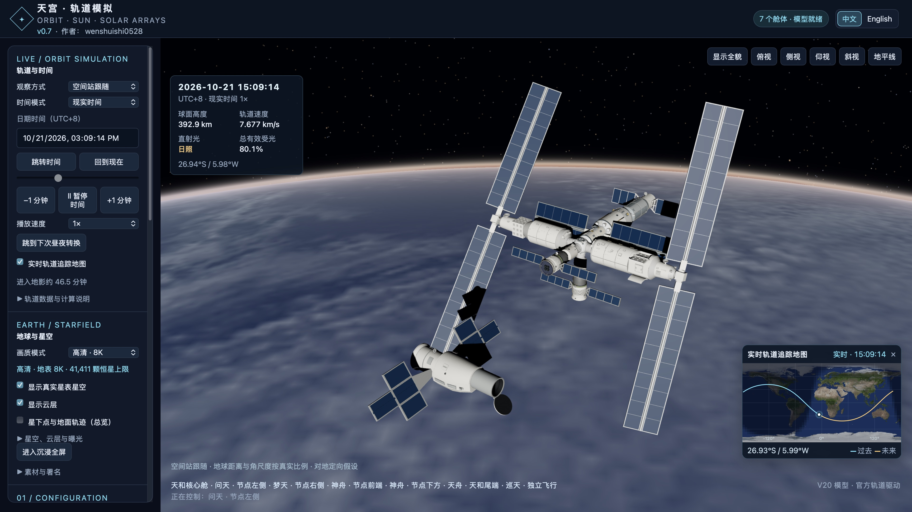
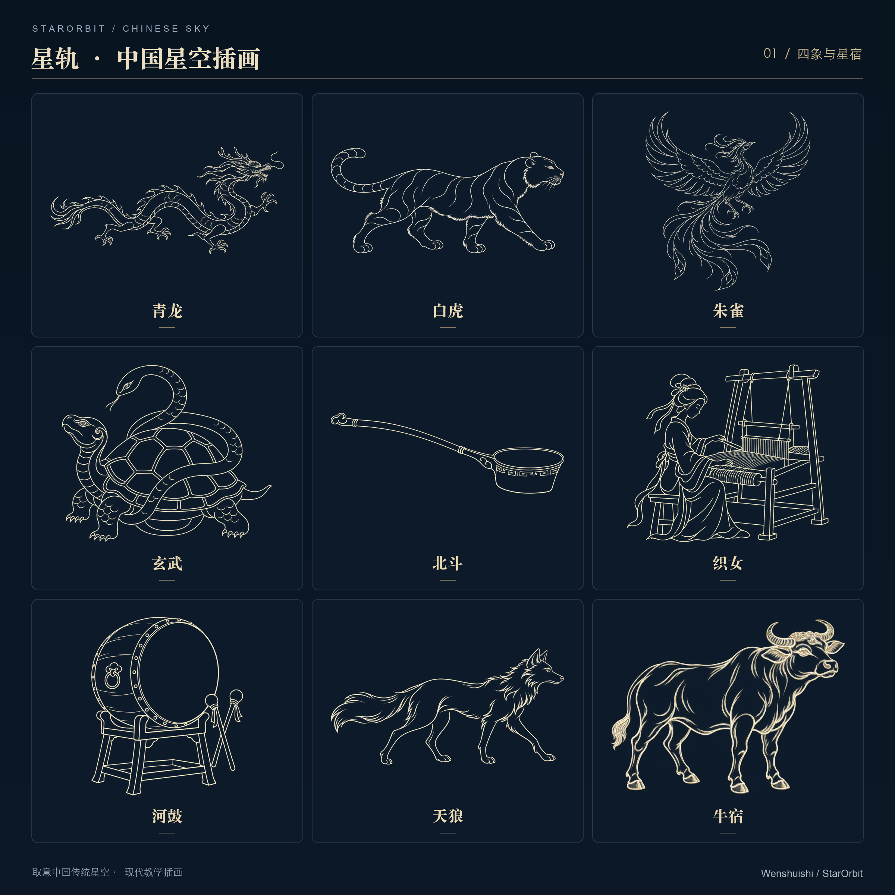
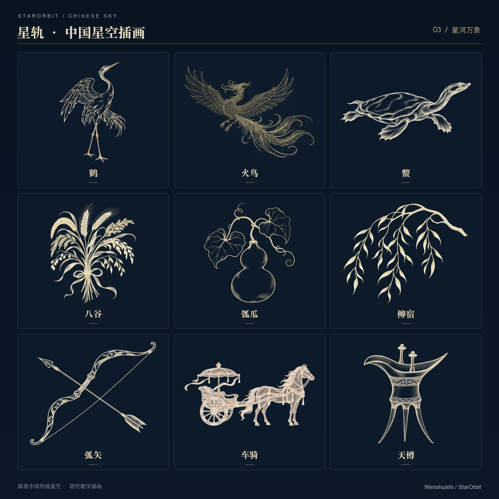

# StarOrbit · 星轨

**Space & Orbit Simulator · Observe, assemble, pilot and photograph spacecraft**

[中文](README.md) | English

[**Launch in your browser**](https://wenshuishi0528.github.io/StarOrbit/) · [Download a published portable release](https://github.com/Wenshuishi0528/StarOrbit/releases/latest) · [User manual (Chinese)](使用说明.md) · [Documentation](docs/README.md) · [Changelog](CHANGELOG.md)

**Author: Wenshuishi · Current source: v1.45 · Original content: [CC BY-NC 4.0](LICENSING.md)**

StarOrbit runs in a browser and combines a self-made China Space Station model with orbital motion, solar arrays, spacecraft attitude, Earth and the sky. It includes spacecraft imports, main-scene piloting, free flight, docking training and observation photography tools, with exploration extending to ground roaming, the Solar System and interstellar travel.

It is intended for space enthusiasts, educational demonstrations and scene creation. Start by watching the station move through day and night, then assemble modules, undock a ship, find a pass or compose an image with the Xuntian telescope. The interface supports Chinese, English, Russian and French. Public orbital and astronomical sources support the calculations; data and models are described below.



> v1.45 brings together recent updates: native 500 m MODIS daytime imagery, Earth science layers, 2D/3D stellar navigation, shared filtered pass lists, date and day/night selection, high-elevation searches, and balcony building/tree obstruction controls. This release restores public source access in the original repository and updates the introduction and Chinese sky gallery. [Full changelog](CHANGELOG.md).

<a id="interface-and-basic-controls"></a>

The lunar observatory combines topocentric phases/libration, rise/set planning, real LRO terrain, surface exploration and captioned exports. See the [current manual](使用说明.md#月球观测).

## Get started

1. Open the [online edition](https://wenshuishi0528.github.io/StarOrbit/). Take the introductory tour or choose an item in **Help** at the upper right.
2. Select the China Space Station or Dong Fang Hong 1 in the left sidebar. Drag with the left mouse button to rotate and use the wheel to zoom.
3. In the orbit and time panel, pause, change the date or adjust playback speed. Compare the readings, ground track and event timeline.
4. Open the **Xuntian viewfinder** from the right toolbar. Search for a star, deep-sky target or city, compose the view and save a photo. On narrow screens, open **Tools** first.
5. Use the feature links below for flight and observation experiments. Full procedures are in the [Chinese user manual](使用说明.md).

First use defaults to detailed 8K overall quality, the enhanced 16K Milky Way and real terrain enabled. If rendering is too demanding, reduce overall quality, disable volumetric clouds or use the ordinary sky mode. The interface reports the imagery level actually loaded.

| Edition | How to open it | Data and network conditions |
| --- | --- | --- |
| Online | Open the website | Bundled resources load from the site on demand; uncached areas and updates need network access, and some conversions require the local service |
| Portable single file | Extract a release and open `StarOrbit.html` | Base runtime assets are embedded; external detail imagery, local elevation and updates still depend on network or cached data |
| Local service | Use the included launcher or `python3 scripts/serve.py --open` | The browser displays the app; the service supplies resources and data conversion. Online updates still need an available source |
| Source checkout | Install dependencies and build | Supports development; build dependencies and raw-data preparation are separate from ordinary use |

<a id="spacecraft-and-missions"></a>
<a id="station-assembly-and-solar-arrays"></a>
<a id="orbits-time-and-attitude"></a>
<a id="earth-sky-and-environment"></a>
<a id="mission-lab"></a>
<a id="photography-scenes-and-preferences"></a>

## What you can do

| Goal | Main capabilities | Procedures |
| --- | --- | --- |
| Observe spacecraft | China Space Station, Dong Fang Hong 1, per-mission orbits and attitude, custom GLB spacecraft | [Missions and spacecraft](使用说明.md#任务与航天器) |
| Assemble the station | Port-based assemblies, repeated modules, constrained array axes and geometric illumination with occlusion | [Assembly](使用说明.md#空间站组合), [solar arrays](使用说明.md#太阳翼与受光) |
| Explore orbits | Time control, ground tracks, sunlight and eclipses, apsides and equator crossings | [Time and events](使用说明.md#时间轨迹与事件) |
| Pilot and fly | Main navball RCS/SAS, Shenzhou and Tianzhou undocking and return, separate docking workbench | [Three piloting modes](#three-piloting-modes) |
| Ground and Solar System | Ground movement, terrain, dated sky, geographic search and linked planetary views | [Ground and Solar System](使用说明.md#地表观测与太阳系) |
| Interstellar travel | Explore stars using distance-based 3D positions, search targets, save waypoints and use 2D/3D navigation maps | [Interstellar travel](使用说明.md#星际穿梭) |
| Explore Earth and sky | Dated surface/night-light choices, cloud library, sunrise and sunset, aurora, sky chart, city imagery and real terrain | [Earth, sky and environment](使用说明.md#地球星空与环境) |
| Explore Chinese astronomy | Qing-era conventional asterisms, Three Enclosures and Twenty-Eight Mansions navigation, member charts, names, lines and symbolic artwork | [Chinese sky culture](使用说明.md#中国传统星官) |
| Use Xuntian | Target search, pinned pointing, formation composition, Solar System targets, real SDO imagery and PNG exports | [Viewfinder](使用说明.md#主页面的巡天望远镜), [solar observations](使用说明.md#太阳观测) |
| Plan observations | Filtered pass lists, high-elevation searches, long exposures, balcony obstructions and viewing windows, survey planning | [Passes](使用说明.md#过境预报), [observation experiments](使用说明.md#长曝光阳台观测与巡天排程) |
| Save and share | Screenshots, birthday sky cards, environment presets, scene JSON, resource snapshots and separate flight saves | [Photography and scenes](使用说明.md#摄影收藏与场景分享), [save scope](使用说明.md#设置保存与恢复) |

The main view, Xuntian finder and photos share Earth and sky resources. Bundled 2025 Sentinel-2 10 m imagery covers Beijing (40 × 40 km) and Seattle (20 × 20 km); other cities support on-demand viewing and downloads. The chart switches between Western constellations and traditional Chinese asterisms, with 88 Western illustrations. The shared deep-sky catalogue has 12,162 display entries. See the [manual](使用说明.md#地球星空与环境) for dates, bands, effective resolution and coverage.

## Chinese asterism illustrations

Traditional Chinese astronomy is one of StarOrbit's distinctive features. Combining source research with OpenAI image-generation assistance, I created modern teaching illustrations in a consistent pale-gold line style, bringing the people, animals, palaces and objects of star names into the 3D sky. The current Qing-era catalogue organisation contains **32 sky regions, 300 independent and 12 subsidiary asterisms**. Illustrations cover all 312 asterism entries, plus seven overviews of the Four Symbols and Three Enclosures — **319 images in total**.

Browse by enclosure, mansion or region, compare artwork with member stars and connections, control asterism and overview layers separately, and include them in viewfinder photographs. The three galleries below show 27 selected images. [Usage guide](使用说明.md#中国传统星官) · [Motifs and production records](assets/chinese-sky/art/README.md).

<details>
<summary>View gallery: Symbols and asterisms</summary>



</details>

<details>
<summary>View gallery: Celestial palaces</summary>


</details>

<details>
<summary>View gallery: Life among the stars</summary>



</details>

## Three piloting modes

| Mode | Purpose and limits | Persistence |
| --- | --- | --- |
| [Main-scene navball](使用说明.md#导航球与近轨操纵) | Pilot the mission spacecraft or independent Xuntian with inertial rotation, RCS and SAS; adds near-orbit motion around a reference orbit | Piloting state belongs to the current page session, rather than a complete flight save |
| [Free flight](使用说明.md#自由飞行) | Copy the current station assembly, undock Shenzhou/Tianzhou and return to the original port, with proximity collisions and checkpoints | Separate mission saves, resumable in the same browser and origin |
| [Docking training](使用说明.md#交会对接训练) | Fixed training scenarios, hold points, assisted/manual controls, instruments and replay reports | Current-session training record; export JSON/CSV to retain it |

The modes share the main attitude and translation keys, but have different dynamics, assistance rules and save scope. Camera targets and piloted objects are also selected separately. Check the active object before taking control.

<a id="data-and-resources"></a>

## Data and simulation models

- **Orbits and time:** OEM records are interpolated inside their interval and continued using the supported model outside it. Modern satellites use public elements and SGP4. Continuation includes orbital perturbations and is shared by the scene and planners. Previous/next high-elevation searches default to an adjustable 60° threshold. Interface date/time inputs use UTC+8; UTC observation times are labelled separately.
- **History and training:** The historical DFH-1 orbit is a source-constrained reconstruction, and telemetry uses reference sensor models. Near-orbit flight and docking are educational/gameplay approximations.
- **Illumination and terrain:** Array output is a geometric illumination fraction. Real terrain supports surface meshes and ground pointing. Orbital altitude readings retain the existing spherical-Earth reference.
- **Imagery and environment:** Surface imagery, night lights, clouds, elevations, sky images and SDO observations keep independent sources and dates. Real imagery uses its labelled observation time. Aurora and atmospheric phenomena include procedural visual models.
- **Network and storage:** Settings, imported models, music and most caches belong to the current browser and origin; the local cloud library also uses disk storage. Downloaded resources and flight records are managed separately. See [resource management](使用说明.md#数据更新与缓存) and [formats and compatibility](docs/formats.md).

See the [product baseline](docs/product-scope.md) for scope and limits, [architecture](docs/architecture.md) for module relationships, and the [documentation index](docs/README.md) for numerical methods and historical evidence.

<a id="源码格式--source-formatting"></a>

## Local use and development

For source development, use **Node.js 22 and Python 3.12**, the CI configuration. Other environments actually checked are listed in the validation record; some scripts require additional Python packages. From the source directory, run:

```sh
npm ci
npm run build
python3 scripts/serve.py --open
```

`npm run build` produces portable HTML and a lightweight local entry; `npm run build:web` creates the static `dist/` site. Some cloud conversions additionally require the optional Python packages in `scripts/cloud-requirements.txt`. Ordinary use does not require regenerating raw Earth imagery, EXR files or catalogues.

See [development and release](docs/development-release.md) for setup, source layout, formatting, builds and publication, and [verification](docs/verification.md) for commands, coverage and current evidence. Source ZIPs and portable release archives serve different purposes.

<a id="documentation-credits-and-licensing"></a>

## Documentation and maintenance

| Document | Purpose |
| --- | --- |
| [User manual (Chinese)](使用说明.md) | Current procedures, keys, readings, saves, offline use and troubleshooting |
| [Product baseline](docs/product-scope.md) | Current scope, constraints, acceptance targets and unsupported behavior |
| [Architecture](docs/architecture.md) | Module responsibilities, data flows and runtime editions |
| [Formats and compatibility](docs/formats.md) | Imports/exports, fields, units and storage boundaries |
| [Development and release](docs/development-release.md) | Setup, checks, builds, distribution and recovery |
| [Verification](docs/verification.md) | Coverage, current acceptance status, evidence and untested items |
| [Technical/history index](docs/README.md), [changelog](CHANGELOG.md) | Reference material and version-specific evidence |
| [Maintenance handoff](HANDOFF.md) | Current status entry points and historical handoffs |

Version-named technical documents may contain the design, procedures and measurements of a past version. Use the manual and current engineering documents for present behavior, then consult history to trace changes. Historical results apply only to their recorded version and conditions.

## Credits

Earth, sky, cloud, orbit, solar, constellation and music resources retain their own attribution and terms. Sources, preparation, resolution, dates, licences and derived processing are collected in the [asset notes](素材与迁移说明.md), with notices also retained beside the relevant assets.

## Why I build and share StarOrbit

A visit to Beijing Planetarium deepened my appreciation of China's own sky tradition and the history, everyday life and imagination carried by its star names. Through StarOrbit, I hope more people can discover this heritage and explore today's China Space Station and space technology for themselves.

I briefly made the source private after finding my work reused without author attribution. After reflecting on its purpose, I decided to make it public again, contributing a practical resource for Chinese astronomical heritage, Chinese spaceflight and science education. I hope an application people can experience, learn from and discuss can help make science more accessible. Improvements and sharing are welcome with attribution under the license.

## Licensing

**Unauthorized commercial use is prohibited.** Original code, models, interface, documentation and Chinese asterism illustrations that the author has rights to license use **[CC BY-NC 4.0](LICENSE)**. Noncommercial modification and sharing are welcome under the license: credit **Wenshuishi / StarOrbit**, link to the project and license, and indicate changes. Commercial use requires separate prior written permission. Third-party libraries, data, music and textures retain their own terms. See [licensing and commercial permission](LICENSING.md) for the full scope and contact route.
