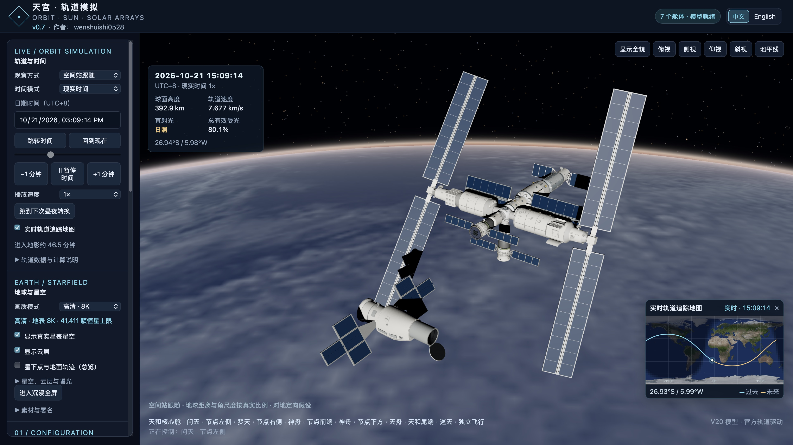
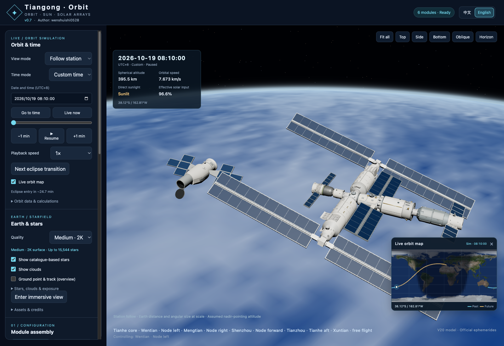

# 星轨 · StarOrbit

**航天与轨道模拟 / Space & Orbit Simulator**

**v0.74 · 作者 / Author: wenshuishi0528**

**[CC BY-NC 4.0](LICENSE) · 原创内容限非商业使用；商用须经作者书面许可。 / Noncommercial use; commercial use requires the author’s written permission. [许可范围 / Scope](LICENSING.md)**
**[打开在线模拟器 / Launch in your browser](https://wenshuishi0528.github.io/StarOrbit/)**

浏览器直接使用，默认内置轨道与云图。首次访问可选择简短导览，右上角“？帮助”通过箭头和高亮定位真实控件，可边看边操作，每个介绍可直接点击“下一个”。画质介绍包含整体画质与星空画质两个入口；首次使用默认为标准 4K 和“观赏增强 · 16K 银河”。[v0.42 引导说明](docs/v0.42-details.md)。[网页版与部署说明](docs/v0.40-details.md)。




## 中文简介

一个可离线运行的通用航天器三维交互与轨道模拟软件。中国空间站、东方红一号和导入的航天器共用地球、NASA 云图、星空、时间与相机操作；每个任务提供自己的模型、轨道和姿态配置。中国空间站支持舱体组合与太阳翼自动追日。

### 主要功能

- **数据与资源**：右上角集中检查 NASA／GitHub 云图、NOAA 极光和当前任务轨道，分别显示下载版本、实际使用版本与检查结果；相同数据复用、失败保留原数据。默认开启缓存自动清理，保护正在使用、收藏和设置引用的快照。[v0.68 使用与验证](docs/v0.68-details.md)。

- **任务实验室**：右上角进入过境预报与交会对接。过境提供三阶段方向指引、时间—仰角曲线、候选观测窗口和日历导出。对接训练台提供末段对准、标准接近与偏差恢复场景，支持人工、位置保持、分段辅助接近及撤离；30 m／5 m 停靠点检查、舰载相机、无推力轨迹预测、接触判定和飞行记录回放形成完整训练流程，可导出 JSON／CSV。[对接训练台与模型范围](docs/v0.71-details.md) · [过境与任务实验室](docs/v0.66-flight-lab.md)。

- **夜面云层**：云层设置新增“夜面也显示云层”，开启后夜面暗云按云图遮挡城市灯光，厚云遮蔽、薄云部分透光；关闭后显示无遮挡夜景，日面亮度不变；普通云层和 8K 体积云均支持，默认关闭，可保存到预设与分享场景。[v0.64 说明](docs/v0.64-details.md)。

- **三轴姿态**：在“航天器姿态”中调节 X 滚转、Y 俯仰、Z 偏航；输入框与滑条实时同步，支持 ±180°、0.1° 精度及归零。空间站与卫星通用，按任务保存。[v0.43 说明](docs/v0.43-details.md)。

- **东方红一号实时遥测**：在音乐播放器的“东方红一号信号”中切换历史录音与实时遥测，选择太阳角计、红外地平仪连续收听或 10 秒实验路序。电压、波形与调频声音随模拟轨道和星体姿态变化；暂停、跳时及倍速切换同步处理。[v0.55 模型与验证](docs/v0.55-details.md)。

- **背景音乐**：内置六首太空音乐，启动随机首曲并默认持续列表循环，最后一首结束后回到第一首，单首歌单重复播放；左下角音符在播放时旋转，鼠标移入展开、离开收起。支持导入、移除、拖动排序、音量和进度控制，普通任务之间保持连续播放。东方红一号专属彩蛋播放《东方红》乐曲与遥测信号，完整播放后间隔 5 秒循环；切走后恢复原歌单进度和播放状态。
- **公共资源**：NASA 已下载云图保存在软件公共目录，启动自动恢复；更新期间继续提供已有云图，切换模型保留云图选择与纹理。
- **任务切换**：中国空间站与东方红一号各有模型、轨道、姿态、自旋和镜头记忆；轨道缺失时可查看模型。后续航天器可在界面中导入配置 JSON、GLB 模型及轨道文件。
- **自由组合**：天和、问天、梦天、神舟、天舟、巡天；各对接口可重复部署同型飞船；新增天和用尾口接入，其节点接口可继续扩展并在左栏分组显示。太阳翼独立调整，也支持实验舱联动。
- **轨道事件时间轴**：底部紧凑显示日照／半影／全影、近远地点和赤道交点，支持 3／12／24 小时窗口、事件筛选与前后导航。拖动保留播放状态，可提前 30 秒观看事件或开启到事件暂停。所有航天器共用，按需计算并缓存。详见 [v0.37 时间轴](docs/v0.37-details.md)。
- **公开访问统计**：顶部显示网页累计访问；本地版读取同一份数字，离线保留缓存。使用固定计数请求，详见 [访问统计说明](docs/v0.53-details.md)。
- **东方红一号历史轨道**：2000 年以前使用近地点 439 km、远地点 2384 km、倾角 68.5°、周期 114 分钟的历史椭圆；从 2000-01-01 00:00（UTC+8）起自动使用现有轨道。详见 [v0.51 说明](docs/v0.51-details.md)。
- **轨道与时间**：采用公开 OEM 轨道记录，在数据区间内插值，区间外接续开普勒椭圆演算；日期与时间合为一条输入栏，默认 24h，可切换并记住 12h；左右键切换时分秒，上下键调整数值；支持现实时间、自定义时间、暂停和最高 1000× 播放；时间步进可选 1s／1m／10m／1h，可连续跨天、跨年跳转并保留播放状态。
- **地面轨迹定向**：计入地球自转，让天和前端沿地面轨迹前进；背景、光照和太阳翼追日使用同一姿态基准。
- **太阳翼追日**：按各实例的单轴／双轴约束求解，考虑舱体与翼板遮挡；地影中继续连续追日，直射受光量保持为零。
- **8K 体积极光**：卷曲亮弧与透明光幕具有高度和厚度，绿色主体向上散开，配有淡红光与局部粉紫底缘。4K 保留原效果；8K 使用分辨率上限、低频形态更新和静止画面缓存。[说明与实拍参考](docs/v0.58-details.md)。
- **四档地球**：1K 简易、2K 流畅、4K 标准、8K 精细；8K可开启体积云和动态演变，另有云图与极光数据模式。
- **平滑阴影**：按模型尺寸适配阴影偏移，消除舱体表面的条纹；静止或仅移动镜头时复用阴影，太阳翼、自旋和太阳方向变化时按需刷新。详见 [v0.34 阴影修复与优化](docs/v0.34-details.md)。
- **光照与清晰度**：辅助开关统一控制补光和金属展示反射；精细档大气合成启用多重采样抗锯齿，窗口缩放和跨屏时同步画布像素比。详见 [v0.32 修复与验证](docs/v0.32-details.md)。
- **地球地点标识**：国家、首都、三级主要城市、国境线、海域、山脉地貌与河湖；北京使用红色五角星，中国轮廓与海上线段来自天地图官方矢量数据。小地图显示当前上空的国家或海域，所有航天器共用。详见 [v0.36 地理与星图](docs/v0.36-details.md)。
- **星图标注**：地理与星图中的二级折叠菜单提供主要恒星、全部已收录星名和精选三项；支持 88 星座名称、连线、边界与标注密度，名称自动避让，所有航天器共用。详见 [v0.35 星图标注](docs/v0.35-details.md)。
- **真实星表星空**：41,411颗独立星点；可选原生16K NASA银河背景、主星名称和曝光风格。增强背景按需加载，切回普通模式释放。
- **实时轨道追踪地图**：显示当前位置、过去及未来地面轨迹，可随时开关。
- **中英俄法四语切换**：顶部右侧一键切换界面、读数、提示和舱体名称，语言选择自动保存。
- **场景分享**：导出／导入 JSON，恢复舱体组合、太阳翼、时间、镜头和环境设置；文件包含所用轨道，下载云图与极光按快照匹配。
- **交互查看**：自由旋转缩放、空间站跟随／轨道总览、沉浸显示、全屏尺寸自适应及三维画面截图。

### 使用

新增航天器：点击左栏 **下载配置模板**，填写模型文件名、单位比例、前向轴、轨道法向轴和轨道文件名，再点击 **导入航天器** 一次选择这些文件。配置与例子见 [模块化任务说明](docs/v0.30-details.md)。

从 **[最新发布页](https://github.com/Wenshuishi0528/StarOrbit/releases/latest)** 下载便携包并解压，用新版 Chrome、Edge 或 Safari 打开 **StarOrbit.html**。约 237 MB 的 HTML 内嵌模型、贴图、星表、计算库和轨道快照，可离线运行。仓库 ZIP 提供源码；可运行便携包位于发布页。

本机开发版通过 `npm run build` 生成轻量入口，启动器保留原地址并按需加载资源，避免浏览器一次解析约 237 MB 的 HTML。更新恢复与稳定性说明见 [v0.72](docs/v0.72-details.md)。

macOS 便携包内附带地球与空间站图标的启动应用，支持 Intel 和 Apple Silicon，双击即可启动后台服务。

源码、网页构建与本机运行版共用 **v0.74**。在线版随 main 分支自动部署，当前部署版本以页面顶部为准；便携包见最新发布页。

顶部显示软件版本和作者。完整操作见 **[使用说明](使用说明.md)**。

中国空间站内置轨道快照覆盖 **2026-10-28 00:00 至 2026-11-04 00:00 UTC**；区间外使用最近端点的位置与速度接续椭圆轨道演算，时间控制可继续前进或后退。使用 **更新轨道数据.command**（macOS）或 `python3 scripts/update-orbit.py` 更新，也可在界面导入支持格式的数据。

东方红一号使用 CelesTrak 的 **DFH 1 / NORAD 4382 / 1970-034A** 根数，通过 SGP4 计算。内置根数历元为 **2026-10-24 03:47:28 UTC**，采样区间为历元前后各三天，区间外接续开普勒椭圆演算；顶部任务栏可切换，轨道数据栏显示当前计算模式。模型顶部短天线校正为星体 +Z；默认顶部朝轨道前进方向，支持开关 120 转/分自旋；下方通用姿态模块可切换惯性定轴示意与手动偏移。详见 [v0.29 任务框架与验证](docs/v0.29-details.md)。

本软件使用模拟姿态与计算太阳翼角度。云图可选内置、下载快照或地理约束生成；体积与运动为示意。普通银河为艺术算法，增强银河来自NASA星表可视化。

## English overview

DFH-1 now includes live telemetry from reference Sun and infrared horizon probes, with continuous channel listening, a 10-second experimental sequence and voltage traces. Select the source in the music player’s DFH-1 signal panel. [Model and validation](docs/v0.55-details.md).



StarOrbit is an offline-capable spacecraft and orbit simulator. China Space Station, Dong Fang Hong 1 and imported spacecraft share Earth, clouds, stars, music and navigation, with independent orbit and attitude configurations.

### Features

- **Data & resources:** A central panel checks NASA/GitHub clouds, NOAA aurora and the active mission's orbit, distinguishing available downloads from data actually in use. Identical data is reused and failures retain existing data. Automatic cache cleanup is on by default and protects active, starred and referenced snapshots. [v0.68 usage and validation](docs/v0.68-details.md).

- **Mission lab:** Pass planning includes viewing directions, elevation curves, candidate optical windows and calendar export. The docking workbench offers terminal alignment, standard approach and offset recovery, with manual control, position hold, gated assisted approach and retreat. It combines 30 m / 5 m hold-point checks, a body-fixed camera, coast prediction, contact checks, recorded replay and JSON/CSV export. [Docking workbench and model scope](docs/v0.71-details.md) · [Pass planning](docs/v0.66-flight-lab.md).

- **Geography & star chart**: two compact second-level panels. Earth labels cover countries, capitals, three city tiers (tier 1 by default), boundaries, seas, landforms, rivers and lakes. Beijing uses a red five-pointed star; China’s geometry comes directly from official Tianditu vectors. A shared subpoint lookup identifies the region below the spacecraft.

- **Background music:** Six built-in tracks, a random opening track and continuous playlist repeat. The last track returns to the first; a one-track playlist repeats that track. A spinning note expands on hover and collapses on exit, with import, removal, drag sorting, volume and seeking. Playback continues across ordinary missions. Dong Fang Hong 1 plays its exclusive melody and telemetry recording with a five-second gap between repeats; switching away restores the previous playlist position and playback state.
- **Shared resources:** NASA cloud images persist in a shared application library, restore on startup and remain available during updates. Switching spacecraft retains the selected environment and texture.
- **Mission switching:** China Space Station and Dong Fang Hong 1 have independent models, orbits, attitude controls, and cameras. Missions without an orbit retain a model preview. New Earth-orbit missions can be imported through the UI using configuration JSON, a GLB model and an orbit file.

- **Configurable assemblies:** Tianhe, Wentian, Mengtian, Shenzhou, Tianzhou, and Xuntian. Deploy multiple copies of any module. Added Tianhe cores connect through their aft ports and expose four node ports for recursive expansion, grouped in the sidebar. Control arrays individually or link laboratory-module rotations.
- **Public visit counter:** The header shows cumulative web visits; the local app reads the same count and retains an offline cache. Uses fixed counter requests. See [details](docs/v0.53-details.md).
- **Dong Fang Hong 1 historical orbit:** Before 2000, uses a 439 × 2384 km ellipse with 68.5° inclination and a 114-minute period. Automatically switches to the current orbit at 2000-01-01 00:00 (UTC+8). See [v0.51 details](docs/v0.51-details.md).
- **Orbit and time controls:** interpolate published OEM records within their sampled interval and propagate a Kepler ellipse outside it; use real time, a custom date, pause, or playback up to 1000×. The 1s/1m/10m/1h steps can continue across days and years while preserving playback state.
- **Ground-track aligned attitude:** account for Earth rotation so Tianhe's front follows the ground track; the background, lighting, and solar tracking share the same attitude frame.
- **Solar-array tracking:** solve single- and dual-axis pointing with sampled body/array occlusion. Tracking continues through eclipse while direct solar input remains zero.
- **Layered aurora in 8K:** Broad diffuse emission, winding bright arcs, diffuse upper red glow and sparse pink-violet lower rims follow simulation time and existing NOAA/procedural modes. 4K keeps the original effect; 8K uses a shared small texture, one draw batch and adaptive detail. [Details](docs/v0.57-details.md).
- **Four Earth quality levels:** 1K simple, 2K smooth, 4K standard, and 8K fine. Optional 8K ray-marched volumetric clouds, illustrative cloud evolution, improved atmosphere, twilight, cloud shadows, and aurora.
- **Smooth spacecraft shadows:** scale-aware bias removes surface stripes; cached shadow maps refresh for solar direction, array motion and spacecraft spin. See [v0.34 validation](docs/v0.34-details.md).
- **Sky annotations:** a compact nested panel provides major stars, all catalogued names and a three-label preset, plus names, lines and boundaries for 88 constellations. Labels avoid overlap and settings are shared across spacecraft. See [v0.35](docs/v0.35-details.md).
- **Catalogue-based stars:** 41,411 independent stars, optional native 16K NASA Milky Way, bright-star labels, and exposure styles. The enhanced background loads on demand and is released in standard mode.
- **Toggleable orbit minimap:** current sub-satellite position with past and future ground tracks, synchronized with simulation time.
- **Chinese / English / Russian / French UI:** switch at the top right; labels, readouts, messages, and module names update without resetting the simulation. Your language choice is remembered.
- **Scene sharing:** export/import compact JSON files with assemblies, solar arrays, time, cameras, environment settings and embedded orbit data. Downloaded weather matches exact local snapshots.
- **Interactive viewing:** orbit/pan/zoom, station-follow and orbit-overview views, immersive display with adaptive fullscreen sizing, and 3D screenshot export.

### Getting started

Download the portable package from the **[latest release](https://github.com/Wenshuishi0528/StarOrbit/releases/latest)**, extract it, and open **StarOrbit.html** in a recent Chrome, Edge, or Safari. The approximately 237 MB HTML embeds the model, textures, catalogue, libraries, and orbit snapshot for offline use. Repository ZIPs contain the source; the runnable portable package is provided on the release page.

On macOS, the portable package includes a launcher app with its own Earth/station icon. It supports Intel and Apple Silicon and starts the local server in the background.

The source, web build and local runtime share **v0.72**. The online edition deploys automatically from main; its current version appears at the top of the page. Portable packages are available on the latest release page.

The China Space Station bundled orbit snapshot is valid from **2026-10-28 00:00 to 2026-11-04 00:00 UTC**. Outside that interval, the nearest endpoint’s position and velocity define a Kepler ellipse for continued simulation. Refresh it with **更新轨道数据.command** on macOS or `python3 scripts/update-orbit.py`, or import supported data in the interface.

Dong Fang Hong 1 uses CelesTrak GP elements for **NORAD 4382 / 1970-034A**, propagated with SGP4. The bundled epoch is **2026-10-24 03:47:28 UTC**, with a ±3-day sampled interval and continued Kepler propagation beyond it. The polar short antenna maps to body +Z; its default prograde orientation and optional inertial-axis mode are illustrative, with toggleable 120 rpm historical spin. The shared attitude panel sits below the display settings. See [mission architecture and validation](docs/v0.29-details.md).

Station attitude follows the ground track; array pointing is computed from the Sun direction. Clouds offer bundled, downloaded and geographically constrained modes; cloud volume and motion are illustrative. The enhanced Milky Way uses NASA catalogue visualization; the standard background is artistic.

## 开发 / Development

Node.js 18+ is required to build; Python 3 is used by the orbit-data scripts.

```sh
npm ci
npm test
npm run build
```

构建后在项目根目录生成 **StarOrbit.html**，可用 **启动星轨.command** 或 **星轨.app** 启动。Generated standalone **StarOrbit.html** is written to the project root; it is distributed as a release asset because it exceeds GitHub’s 100 MB per-file limit.

- `src/`: application, orbit/solar calculations, Earth/stars, and minimap.
- `assets/`: required model, prepared textures, catalogue, and orbital records.
- `build.mjs`: build the self-contained HTML; version and author come from `package.json`.
- `scripts/update-orbit.py`: refresh and validate the published orbital data, then rebuild.
- `scripts/prepare-environment.py`: optional texture/catalogue preparation; requires Pillow and the original attributed source textures in `assets/earth/source/`. Prepared assets are already included for normal builds.

## 素材与署名 / Credits

- Earth textures: [Solar System Scope / INOVE](https://www.solarsystemscope.com/textures/), **CC BY 4.0**; resized and compressed for the four quality levels.
- Star catalogue: [d3-celestial / XHIP](https://github.com/ofrohn/d3-celestial), **BSD 3-Clause** notice retained in `assets/D3-CELESTIAL-LICENSE.txt`.
- Starfield styling and artistic Milky Way: adapted from [StarSky Studio](https://github.com/Wenshuishi0528/StarSkyStudio), **CC BY 4.0**.
- DFH 1 orbit: [CelesTrak GP JSON](https://celestrak.org/NORAD/elements/gp.php?CATNR=4382&FORMAT=JSON), propagated with [satellite.js](https://github.com/shashwatak/satellite-js) **6.0.2 / MIT**.
- Orbit source: [China Manned Space Engineering Office / BACC](https://en.cmse.gov.cn/news/202107/t20210722_48418.html).
- Three.js, Astronomy Engine, satellite.js, and three-mesh-bvh: **MIT**; notices are embedded in the standalone HTML.

Full asset notes: **[素材与迁移说明.md](素材与迁移说明.md)**. Third-party materials retain their respective licenses. Original project content is licensed under **CC BY-NC 4.0**; commercial use requires separate written permission from the author. See [licensing scope](LICENSING.md) and the [full license](LICENSE).


### Earth & weather update / 地球与天气增强

- 1K / 2K / 4K / 8K，8K可选体积云与连续演变；大气边缘、晨昏、夜景、云影和海面反光升级。
- 云图与极光独立选择最新数据、已保存历史、本地生成或关闭。极光使用 NOAA OVATION 预测网格；程序生成的光幕与云层立体形态是示意。
- 一键检查云图、极光和轨道；失败保留旧数据。历史缓存支持收藏、容量限制、删除与导入导出。云图未提供观测时刻时明确显示未知。
- 摄影模式、固定曝光、4K宽PNG截图和环境视角收藏；保留原有自由组合、全屏适配、轨道与太阳能板计算。
- 双击 `启动星轨.command` 可开启本地服务及固定来源的官方轨道中继。直接打开HTML仍能离线运行；云图/极光可按需联网更新，持久缓存能力取决于浏览器。

Four quality tiers with optional 8K ray-marched clouds and illustrative continuous weather evolution. Improved atmospheric limb, twilight, ocean glint and cloud shadows. Clouds and aurora offer downloaded, saved-history, procedural and off modes. NOAA OVATION supplies forecast coverage, not observed auroral curtains. One update button checks each source independently; failures retain existing data. Favorite/export/import snapshots, manage the cache budget, use photo mode and 4K-wide captures, and save reproducible environment presets. Existing orbital physics, solar tracking, fullscreen sizing and recursive assembly remain intact. Run `python3 scripts/serve.py --open` for the local viewer and official-orbit relay, or open the offline HTML directly. Historical coverage is limited to snapshots actually available in the local library.

Clouds: [Live Cloud Maps](https://github.com/matteason/live-cloud-maps) — **Contains modified EUMETSAT data**. Aurora: [NOAA SWPC OVATION](https://www.swpc.noaa.gov/products/aurora-30-minute-forecast). Procedural weather, cloud height and curtain motion are illustrative.
Settings memory / 设置记忆：银河默认开启。组合、太阳翼控制、时间、视角、显示、环境和语言设置会在同一浏览器及地址下自动恢复。恢复出厂设置重置偏好和组合，保留下载快照与收藏。

The Milky Way is enabled by default. Assembly, solar controls, time, cameras, display, environment and language preferences are remembered in the same browser and origin. Factory reset restores preferences and assembly while retaining downloaded snapshots and favorites. Native browser fullscreen still requires a click.

Native 16K sky / 原生16K星空：[NASA SVS Deep Star Maps 2020](https://svs.gsfc.nasa.gov/4851/). Credit: NASA/Goddard Space Flight Center Scientific Visualization Studio; Ernie Wright; Gaia DR2: ESA/Gaia/DPAC. Native 16384×8192 source, no upscale or added blur. Device limits are shown explicitly when 8K/4K fallback is needed. The 356.5 MB source EXR and development dependencies are not needed to run the standalone app.

小地图支持拖动站点或点击轨迹跳转到对应有效时刻，并自动暂停；不把空间站放到任意无效轨道位置。The minimap supports dragging the station or clicking the track to seek and pause at a valid orbital time.

### Close-range Earth clarity / 近距离地球清晰度

8K 档新增原生 21600×10800 NASA 地表的按需分块细节，最多四块常驻显存，离线可用。普通云层使用单层覆盖以避免叠层重影；大气与地表不再重复雾化，8K 像素比上限固定为 2。

The 8K tier adds on-demand native 21,600×10,800 Earth detail, with at most four decoded tiles resident and offline support. A single ordinary cloud layer avoids duplicated silhouettes; atmospheric haze is no longer added twice, and the 8K pixel-ratio cap is independent of starfield settings.

Source: [NASA Earth Observatory — Blue Marble Next Generation](https://science.nasa.gov/earth/earth-observatory/blue-marble-next-generation/base-topography/), July 2004 composite with topography. Details and SHA-256 hashes: `assets/earth/detail/manifest.json`.


### Ocean, night lights and twilight / 海洋、夜景与晨昏

8K 档修正深海颜色，并加入 NASA Black Marble 2016 的城市夜光细节：500 米灰度源数据降采样至约 1 公里，按当前视野加载最多四块夜景切片，与最多四块地表切片共用单路解码。晨昏大气在地影边界分段积分，使用连续半影和轻微抖动消除条带。望月按钮可再次点击返回；顶部也提供「返回空间站」。单文件 HTML 约 237 MB。

The 8K tier corrects deep-ocean reflectance and adds NASA Black Marble 2016 city lights, downsampled from 500 m sources to approximately 1 km. At most four night tiles and four daytime tiles are resident, with one shared decode queue. Atmosphere integration splits at the Earth-shadow boundary, with continuous penumbra and sub-code-value dithering. Look at Moon toggles back to the saved station view; a permanent Back to station action is also available. Standalone HTML: approximately 230 MB.

Night-light source: [NASA Earth Observatory — Black Marble 2016](https://science.nasa.gov/earth/earth-observatory/earth-at-night/maps/), Suomi NPP / VIIRS historical composite. The light map represents city-light distribution, not individual buildings or current imagery. Tile and source hashes: `assets/earth/night-detail/manifest.json`.
