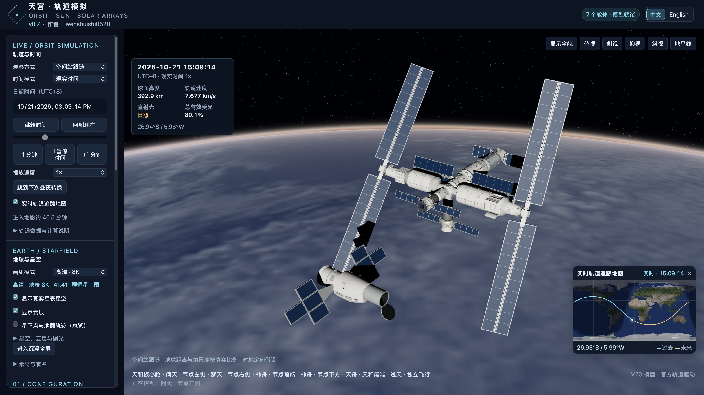

# 星轨 · StarOrbit

**航天与轨道模拟 · 观察、组合、操纵与拍摄航天器**

中文 | [English](README.en.md)

[**在线体验**](https://wenshuishi0528.github.io/StarOrbit/) · [下载已发布便携版](https://github.com/Wenshuishi0528/StarOrbit/releases/latest) · [使用手册](使用说明.md) · [文档导航](docs/README.md) · [更新记录](CHANGELOG.md)

**作者：Wenshuishi · 当前源码：v1.25 · 原创内容许可：[CC BY-NC 4.0](LICENSING.md)**

星轨是一款在浏览器中运行的三维航天与轨道模拟软件。它把自制中国空间站模型、轨道运动、太阳翼与姿态、地球和星空放进同一场景，并提供航天器导入、近轨操纵、自由飞行、交会对接训练和观测摄影工具。

它面向航天爱好者、科普教学和场景创作。你可以从观察空间站的昼夜变化开始，再尝试组合舱体、驾驶飞船离站、寻找一次过境，或用巡天望远镜构图。公开轨道与天文资料为计算提供依据，历史重建、训练模型和视觉效果各有明确适用边界。



> v1.25 扩展中国星空全目录插画，修复四象／三垣总览并增加独立透明度；月球新增完整正式地名、着陆点及可旋转的中科院三维地质图。功能实测范围见[验证总览](docs/verification.md)；在线版和下载包以各自界面版本为准。

<a id="界面与基本操作"></a>

月球观测工作台提供地面月相与天平动、升落/月相规划、真实三维地形、月面探索和带说明的图片导出，入口见[使用手册](使用说明.md#月球观测)。

## 立即开始

1. 打开[在线版](https://wenshuishi0528.github.io/StarOrbit/)，完成“快速导览”或从右上角“？帮助”选择操作。
2. 在左栏“任务选择”选择中国空间站或东方红一号，左键拖动观察、滚轮缩放。
3. 在“轨道与时间”暂停、跳转时刻或改变播放速度，对照读数、小地图和事件时间轴。
4. 从右侧工具列打开“巡天取景”，搜索恒星、深空目标或城市，调整构图后保存照片。窄窗口先打开“工具”。
5. 需要飞行或观测实验时，按下面的功能入口进入。完整步骤见[使用手册](使用说明.md)。

首次使用默认选择精细 8K 整体画质、观赏增强 16K 银河，并开启真实地形。设备负担较大时，先降低整体画质，再关闭体积云或切回普通星空；实际加载档位以界面为准。

| 运行方式 | 如何打开 | 数据与联网条件 |
| --- | --- | --- |
| 在线版 | 直接打开网站 | 内置资源按需从网站取得；未缓存区域和在线更新需要网络，部分转换依赖本机服务 |
| 便携单文件版 | 解压发布包，打开 `StarOrbit.html` | 内嵌基础运行素材；按需外部影像、局部高程及更新仍受网络或缓存条件限制 |
| 本机服务版 | 包内启动器，或 `python3 scripts/serve.py --open` | 浏览器显示界面，本机服务提供资源和数据转换；在线更新仍需可用来源 |
| 源码开发版 | 安装依赖并构建 | 可修改程序；开发依赖、原始数据制备与正常运行分开 |

<a id="航天器与任务"></a>
<a id="空间站组合与太阳翼"></a>
<a id="轨道时间与姿态"></a>
<a id="地球星空与空间环境"></a>
<a id="任务实验室"></a>
<a id="摄影场景与个性化"></a>

## 软件能做什么

| 目标 | 主要能力 | 操作入口 |
| --- | --- | --- |
| 观察航天器 | 中国空间站、东方红一号、任务独立轨道与姿态、自定义 GLB 航天器 | [任务与航天器](使用说明.md#任务与航天器) |
| 组合空间站 | 接口装配、重复舱体、太阳翼转轴与遮挡受光 | [空间站组合](使用说明.md#空间站组合)、[太阳翼](使用说明.md#太阳翼与受光) |
| 理解轨道 | 时间播放、地面轨迹、昼夜／地影、近远地点与赤道交点 | [时间与事件](使用说明.md#时间轨迹与事件) |
| 操纵与飞行 | 主导航球 RCS／SAS、神舟与天舟离站回接、独立对接训练台 | [三种操纵方式](#三种操纵方式) |
| 观察地球与星空 | 地表与夜光年代选择、云图库、朝阳夕阳、极光、星图、城市影像与真实地形 | [地球、星空与环境](使用说明.md#地球星空与环境) |
| 探索中国星空 | 清代通行星官整理、三垣二十八宿导航、成员图、名称连线和四象／代表星官图像 | [中国传统星官](使用说明.md#中国传统星官) |
| 使用巡天望远镜 | 目标搜索、固定瞄准、伴飞构图、太阳系天体、真实 SDO 太阳影像和 PNG | [巡天取景](使用说明.md#主页面的巡天望远镜)、[太阳观测](使用说明.md#太阳观测) |
| 规划与演示观测 | 过境预报、轨道长曝光、阳台观测、巡天四格排程与观测记录 | [过境预报](使用说明.md#过境预报)、[观测实验](使用说明.md#长曝光阳台观测与巡天排程) |
| 保存与分享 | 截图、环境收藏、场景 JSON、数据快照、独立飞行存档 | [摄影与场景](使用说明.md#摄影收藏与场景分享)、[保存范围](使用说明.md#设置保存与恢复) |

工具列的「宇宙探索馆」提供五类极端天体与大气现象的交互教学演示，支持参数探索、暂停／拖动进度、四语言说明和带署名的示意图导出。[使用方法与科学边界](使用说明.md#宇宙探索馆)

主画面、巡天取景与照片共用当前地球和星空资源。内置北京 40 × 40 km、西雅图 20 × 20 km 的 2025 年 Sentinel-2 10 米影像；其他城市可按需查看或下载。星图可切换西方星座与中国传统星官，提供 88 星座教学插画、中国体系 32 天区、300 个独立及 12 个附属星官的成员资料，以及 312 幅星官插画和 7 幅四象／三垣总览。两类插画分别控制，总览默认关闭；深空目录包含 12,162 个显示项。目录标注与插画覆盖分别管理，数据年代、波段、实际分辨率和缺覆盖回退见[手册](使用说明.md#地球星空与环境)。

## 三种操纵方式

| 方式 | 用途与边界 | 保存方式 |
| --- | --- | --- |
| [主页面导航球](使用说明.md#导航球与近轨操纵) | 在主场景操纵当前任务航天器或独立巡天，体验惯性转向、RCS 和 SAS；基于参考轨道叠加近轨运动 | 本次页面内的操纵状态；不作为完整飞行存档 |
| [自由飞行](使用说明.md#自由飞行) | 复制当前空间站组合，驾驶神舟、天舟离站并回到原接口，有近站碰撞与检查点 | 独立任务存档，可在同一浏览器和地址继续 |
| [交会对接训练](使用说明.md#交会对接训练) | 固定训练场景、停靠点、辅助／纯手动控制、仪表和回放报告 | 本次训练记录；需要保留时导出 JSON／CSV |

三者共用主要姿态和平移键位，各自的动力学、辅助规则和保存范围不同。镜头观察对象与驾驶对象也分别选择；开始操纵前先核对当前对象。

<a id="数据与资源"></a>

## 数据与计算说明

- **轨道与时刻**：OEM 记录区间内插值，区间外按支持的模型接续；现代卫星使用公开根数与 SGP4。过境预报另行检查数据有效期。界面日期时间输入使用 UTC+8，观测资料的 UTC 时刻单独标明。
- **历史与训练**：东方红一号历史轨道为资料约束重建，遥测为参考传感器模型；近轨与对接是教学和玩法近似。
- **受光与地形**：太阳翼读数是几何有效受光比例；真实地形改变显示网格与地面瞄准，不增加着陆或地形碰撞物理。轨道高度读数仍采用既有球形地球基准。
- **影像与环境**：地表、夜光、云图、高程、星空和 SDO 影像分别保留来源及年代。模拟时钟不会生成对应日期的实拍资料，极光与奇观的动态形态包含程序化渲染。
- **联网与保存**：设置、模型、音乐和多数缓存保存在当前浏览器与地址下；本机云图库另存磁盘。场景文件不包含所有下载资源或独立飞行记录。见[数据管理](使用说明.md#数据更新与缓存)与[格式和兼容](docs/formats.md)。

当前支持范围与约束见[产品基线](docs/product-scope.md)，模块关系见[系统架构](docs/architecture.md)，数值依据与历史验证由[文档导航](docs/README.md)索引。

<a id="源码格式--source-formatting"></a>

## 本地运行与开发

源码开发建议使用 **Node.js 22、Python 3.12**（CI 配置）。其他版本的实际验证环境见验收记录；部分脚本需要另装 Python 依赖。先在源码目录执行：

```sh
npm ci
npm run build
python3 scripts/serve.py --open
```

`npm run build` 生成便携 HTML 与本机轻量入口；`npm run build:web` 生成静态网站 `dist/`。部分云图转换另需安装 `scripts/cloud-requirements.txt` 中的可选 Python 依赖。普通运行无需重新制备原始地表、EXR 或星表。

开发目录、环境安装、格式化、构建与发布步骤见[开发与发布指南](docs/development-release.md)；测试命令、覆盖和当前证据见[验证总览](docs/verification.md)。仓库源码 ZIP 与发布页便携包用途不同。

<a id="文档素材与许可"></a>

## 文档与维护

| 资料 | 阅读目的 |
| --- | --- |
| [使用手册](使用说明.md) | 当前操作、快捷键、读数、保存、离线和故障处理 |
| [产品基线](docs/product-scope.md) | 当前功能范围、约束、验收目标与未实现边界 |
| [系统架构](docs/architecture.md) | 模块职责、数据流和运行方式 |
| [格式与兼容](docs/formats.md) | 导入导出、字段、单位和存储边界 |
| [开发与发布](docs/development-release.md) | 搭建、检查、构建、分发与恢复 |
| [验证总览](docs/verification.md) | 测试覆盖、当前验收状态、证据与未测项 |
| [技术与历史索引](docs/README.md)、[更新记录](CHANGELOG.md) | 数据模型、专题参考与历次变更证据 |
| [维护交接](HANDOFF.md) | 当前状态入口和历史交接记录 |

带版本号的技术文档可能包含当时的设计、操作与测量结果。查当前行为先看手册及现行工程文档，追溯变更再看历史记录；历史验证结果只适用于其版本和条件。

<a id="素材与署名--credits"></a>

## 素材与署名

地球、星空、云图、轨道、太阳观测、星座插画和音乐来自不同资料或第三方作品，保留各自署名与条款。来源、制备、分辨率、年代、许可及派生处理集中在[素材与迁移说明](素材与迁移说明.md)，素材目录同时保留相应声明。

## 许可

作者拥有授权权利的原创代码、模型、界面和文档采用 **[CC BY-NC 4.0](LICENSE)**；商业使用须事先取得作者书面许可。第三方库、数据、音乐和贴图继续适用各自条款。完整范围及联系入口见[许可与商业授权](LICENSING.md)。
