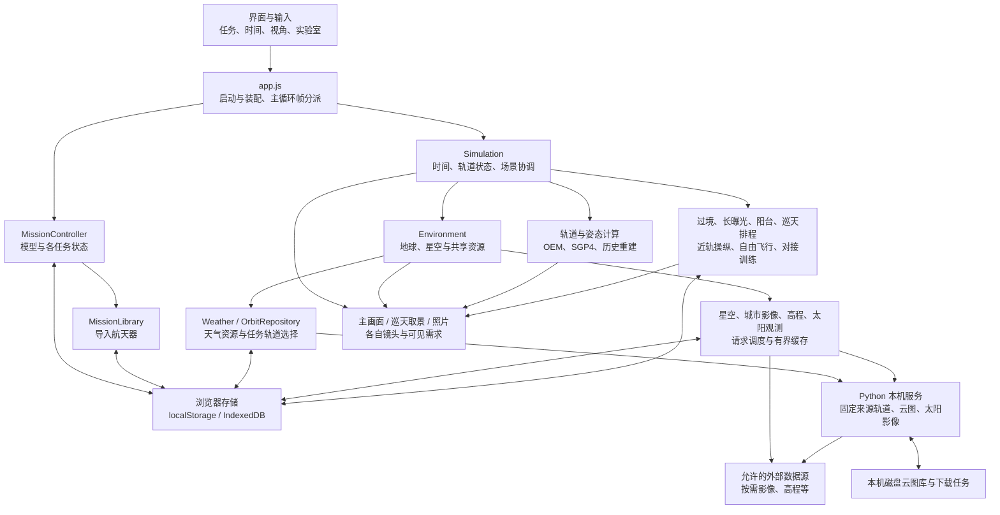

# 系统架构与状态边界

适用版本 v1.71。作者 Wenshuishi。

本页说明当前源码的模块关系、状态归属和修改时需要保留的边界，按子系统组织。具体能力见[产品范围](product-scope.md)，字段见[数据格式与本机接口](formats.md)，操作见[使用手册](../使用说明.md)，执行结果见[验证指南](verification.md)。这里的结构描述不代表某一批已经完成运行验收。

## 总体关系

图中的箭头表示主要调用或数据依赖，不表示所有模块都通过统一消息总线通信。当前实现使用 JavaScript 模块、共享对象、事件和直接方法调用；浏览器中的 `window.viewer` 主要用于运行诊断和浏览器测试，不是承诺兼容的扩展 API。

## 模块职责与修改入口

### 专业版轨道、观测与回放

专业版以独立 HTML 作为浏览器入口。`src/pro/mission.js` 在同一条 24 小时轨迹上运行两套独立的设备、电池和热状态。`orbit-propagation.js` 提供数值传播与可选摄动，`oem.js` 处理外部星历，`orbit-comparison.js` 计算同历元 RTN 偏差并提供数值轨迹稠密插值。太阳、有限日面遮挡和地球自转沿用共享环境模块。网页在可取消的 Web Worker 中求解，Node CLI 使用同一计算入口。`products.js` 输出工程遥测和逐图阶段表。外部卫星 AI 可以离线生成任务 JSON 并读取逐图结果。[数据格式](formats.md#专业版任务与结果)

**共同的观测机会。** `observation-config.js` 校验输入。`access.js` 将目标和接收站的 WGS84 大地经纬度、椭球高换算至地固坐标，在相应 UTC 转入 EME2000。目标窗口取三项条件的交集，包括当地地平线以上可见、航天器相对地心星下方向的离轴角合格、目标处太阳高度合格。接收站窗口单独按当地卫星仰角求解。各不等式分别扫描、查找局部极值并细化边界至 0.001 s 的求根容差。直接 OEM 回放沿文件分段采样，位置跳变处分开求窗。每一目标窗先扣除稳定时间，再按节拍放置可以完整曝光的候选。窗口容差描述数值求根，实测视线精度还受星历、地球定向和站址误差影响。

**两套独立的设备队列。** `observation-run.js` 以同一种子和候选编号派生两个伪随机抽样，分别确定任务定义下的有用真值和分类器保留判决。两个方案共享候选与抽样，每个方案各有一个相机、处理器、数传机和定容记录器。整幅曝光结束时才申请原图空间，写满则记录溢出。筛选策略在单处理器上按入队顺序工作，处理结束时才释放被筛除或压缩掉的字节。下传按就绪顺序从队首发送，站窗结束时保留断点，已确认的部分立即释放存储。若传输、处理和曝光同时结束，先回收已发送或处理释放的存储，再接纳新图。

**功率与热耦合。** 平台和原载荷先获电。其余功率依次分配给相机、无线电、处理器。固定曝光需连续满功率，任一中断即作废。无线电与处理器可暂停恢复，有限供电按获得功率与额定功率之比折算吞吐。电池和光伏均无法维持基础负载时，所有观测设备挂起，包括配置为零额外功耗的设备。调度器在曝光、等待到期、处理完毕、站窗边界和整幅送达处分段，电源再按可用电池能量截断区间。外层电热时钟默认 5 s，使用中点轨道环境与区间初始外表面温度计算光伏。区间内把实际用电与电池损耗逐段累积成焦耳，设备板和外表面同步更新。观测任务的电池预留线按子区间斜率定位，温度限值按电热网格判定。

**回放与适用范围。** 轨道事件按所在的数值轨迹或原 OEM 插值，地面标记随地球转动，电量按电池节点重建。观测事件的存储读数按写入、筛除、压缩及下传速率转折节点重建，同时事件处显示处理后的占用。板温和设备平均功率使用最近网格点及其采样时刻。目标指向采用理想可达角与固定稳定时间，帆板仍采用各方案规定的指向。独立执行的成像、处理、数传允许重叠。实际整星共用指向、转动时间和力矩、视场覆盖、云场、地形遮挡、折射、天线方向图、调制编码、协议开销、链路重传及传播时延需在具体任务中另行建模。当前站内速率代表通过这些环节后可用的有效载荷吞吐。

工作台沿用 `starorbit-pro-mission-v1` 保存成功运行的输入。大文件可转存 IndexedDB 的 `starorbit-pro-files`，存储失败时由界面提示导出任务。三维回放依据实际状态画轨迹与太阳翼，卫星外形放大显示，预测和参考位置之间的距离按世界坐标绘制。专业版有中、英、俄、法界面。单文件内嵌求解器、地球昼夜底图、归档示例星历和许可说明，普通浏览器与离线入口分别保存任务。

### 用载荷试验标定筛选策略

Giuffrida 等为 Φ-Sat-1 的 CloudScout 云量分类器做了板级测试。输入是 512 × 512 像素、三个波段的图块，网络输出云量二分类。EoT 板上的 Myriad 2 每次推理耗时 325 ms，作者报告的平均功率为 1.8 W。两数相乘约为 0.585 J/图块。论文第 4 节和表 5 的工作负载是板上单次推理，星轨的计量单位是一整幅任务影像。整幅的切块数、预处理、读写和编码，以及平台预算已包含的板卡待机功率，都会改变配置值。[CloudScout 原始论文，第 3–5 节和表 5](https://doi.org/10.3390/rs12142205)

对自己的载荷，可在同一电源测点记录空闲基线、一整幅流水线的实际工作时长和能量，再以增量能量除以工作时长填写 `processorW`，以满供电工作秒数填写 `processingSec`。另按原图和保留产物的字节数计算 `outputFraction`。在本任务真实样本上标注“有用”，分别用有用样本的保留比例和无用样本的误留比例填写 `usefulKeep/otherKeep`，记录场景、模型及数据版本至 `parameterSource`。示例中的 14 W、14 s 和合成概率属于可替换的研究假设。

### 普通版主要模块

| 职责 | 当前主要源码 | 修改时需要一起考虑的关系 |
| --- | --- | --- |
| 启动、站体装配、主循环 | `src/app.js`、`assembly.js`、`runtime-assets.js` | 模板模块、转轴、比例、启动恢复顺序；不能让首帧覆盖已保存翼角；新的全屏或模态视图要登记到帧分派表 |
| 时间推进 | `sim-clock.js`、`simulation.js` | 多字段的播放、暂停交还和自绘视图推进只经共用函数；会话与场景恢复仍直接写字段 |
| 按需加载 | `lazy-data.js`、各数据的加载函数、`build.mjs` | 启动可达模块不能静态导入按需数据；加载失败不缓存；单文件版保持离线 |
| 轨道、时间与总体状态 | `simulation.js`、`orbit.js`、`gp-orbit.js`、`dfh1-history.js` | 有效期、坐标转换、历史与现代分支、事件求解和预报边界 |
| 任务注册与模型切换 | `missions.js`、`mission-controller.js`、`mission-package.js`、`mission-library.js` | 模型轴向、能力开关、轨道归属、镜头记忆及异步切换 |
| 姿态、受光和阴影 | `spacecraft-attitude.js`、`solar.js`、`spacecraft-lighting.js`、`spacecraft-shadow.js` | 地面轨迹定向与速度定向不同；受光读数不等于发电功率 |
| 舱段名称 | `spacecraft-labels.js`、`spacecraft-label-layout.js`、`spacecraft-label-placer.js` | 名称规则、避让布局和页面读写分开；布局为纯函数 |
| 公共环境和天体 | `environment.js`、`earth-shaders.js`、`atmosphere-*.js`、`moon.js`、`star-chart.js` | 多视图的时间、太阳方向、环境开关和地球自转应一致 |
| 资源获取和天气库 | `weather.js`、`orbit-repository.js`、`resource-fetch.js`、`resource-recovery.js`、`weather-cache.js`、`cloud-library.js` | 下载完成与实际使用是两个状态；重复请求、失败保留、缓存保护和任务隔离 |
| 高清星空、城市影像和高程 | `sky-detail*.js`、`city-terrain*.js`、`earth-elevation*.js` | 主画面／取景／照片的视野需求、共享请求、有界驻留、取消和关闭释放 |
| 太阳观测 | `solar-data.js`、`solar-cache.js`、`xuntian-solar-view.js` | 真实观测时间、波段、几何元数据、PNG 尺寸以及本机与网页能力差异 |
| 巡天取景和照片 | `xuntian-scope.js`、`xuntian-view-render.js`、`exposure-earth-fast.js`、`exposure-lab-render.js` | 相机光轴、景深精度、源数据状态、照片准备和署名 |
| 近轨操纵与独立训练 | `main-flight*.js`、`free-flight*.js`、`docking-*.js` | 主场景操纵、独立自由飞行、对接训练各有状态；键盘焦点和清空推力需共同回归 |
| 保存、场景和观测记录 | `session-memory.js`、`scene-format.js`、`scene-share.js`、`observation-store.js` | 当前网址的偏好、完整场景、观测配方和独立飞行存档用途不同 |
| 本机服务和分发 | `scripts/serve.py`、`build.mjs`、`scripts/package-portable.py`、`macos/Launcher.swift` | 服务工作根目录、构建方式、入口重定向、启动器引用和发布证据 |

源码路径均相对于源码仓库。便携包不包含完整源码；可查阅固定公开基线的 [app.js](https://github.com/Wenshuishi0528/StarOrbit/blob/5ed3d96b52db26f5e9500430eec3a67a32d14f35/src/app.js)、[Simulation](https://github.com/Wenshuishi0528/StarOrbit/blob/5ed3d96b52db26f5e9500430eec3a67a32d14f35/src/simulation.js)、[Environment](https://github.com/Wenshuishi0528/StarOrbit/blob/5ed3d96b52db26f5e9500430eec3a67a32d14f35/src/environment.js)。这些固定链接只对应其历史提交，当前结构以工作副本为准。

## 启动、按需加载与主循环

### 启动包与按需数据

网页版和本机版的程序是 ES 模块：入口及其静态导入在启动前下载（v1.67 未压缩合计约 7.33 MB），只经 `import()` 到达的模块和 JSON 由打包器拆成分块，首次使用时取得。单文件版把同样的 `import()` 留在一个内联 IIFE 里解析，内容全部内置，可离线打开。Node 测试直接执行同样的 `import()`，JSON 导入统一带 `with { type: 'json' }`，否则打包器会把同一文件当作两个模块各打包一份。

启动包保留主画面首帧需要的内容：Three.js、星表 `stars.json`、西方星图 `star-chart.json`、深空目录、英文词典（静态界面文字的键集合与回退）和恒星距离表。以下内容按需加载：

| 内容 | 加载入口 | 何时开始 | 加载前的行为 |
| --- | --- | --- | --- |
| 地理图集（约 4.3 MB） | `geography-atlas.js` | 地理标注首帧、地名搜索、巡天打开、位置地图、天体观测地球 | 标注与位置读数暂不显示；搜索等到图集后重新执行 |
| 哈勃图集目录（约 1.8 MB） | `hubble-gallery.js` 的 `loadHubbleArchive()` | 选择哈勃图源、打开影像目录、打开或续传哈勃离线记录 | 图源状态为加载中；照片准备会等待；默认「自动」图源不加载 |
| 中国星官目录（约 3 MB） | `sky-cultures.js` 的 `ensureSkyCulture()` | 选择中国体系、恢复已保存体系、导入场景或环境收藏、巡天搜索首次使用 | 继续显示当前体系；同步读取未加载体系会抛错，不回退成西方 |
| 中国星官插画配准（约 2.6 MB） | `chinese-sky-art.js` 的 `loadChineseSkyArt()` | 与中国目录一起，由 `Environment.loadSkyCulture()` 加载 | 同上 |
| 俄文、法文词典 | `i18n.js` | 切换语言，或启动时已保存该语言 | 保持当前语言；`setLanguage()` 返回 Promise，只采用最后一次选择 |
| 四语帮助手册 | `help-content.js` 的 `loadHelpContent()` | 首次打开帮助、导览或手册，及帮助打开时切换语言 | 面板显示「正在载入…」；导览页目录 `tours.json` 留在启动包 |
| 任务实验室七个页签与观测记录 | `flight-lab.js` | 首次显示该页签 | 页签内显示载入状态；`sim.flightLab.open()` 返回 Promise |

`lazy-data.js` 是共用包装：`load()` 让并发调用共享同一次加载，失败不缓存，下次调用重新尝试；`get()` 供渲染循环同步读取，未加载时在后台开始加载并返回 `null`，失败后等待 30 秒再试，避免每帧重复请求。新增按需数据时，确认启动可达的模块里没有任何静态导入，`tests/web-build.mjs` 对启动脚本总量设有上限。

中国星官的约定是：只有 `Environment.selectSkyCulture()` 改变显示体系，数据就绪后才写入 `settings.skyCulture`，因此读取该设置的渲染器不必再等待。地名搜索、巡天和地面星图搜索在数据到达后刷新结果。网页版重新部署后，旧页面请求的分块可能已不存在；加载失败会在对应面板说明，刷新页面即可。

### 启动与恢复顺序

`app.js` 的 `boot()` 先确保模型和内置轨道就绪，再恢复各层状态：

1. 建立 WebGL renderer、相机、鼠标控制、侧栏、语言和音乐；已保存俄文或法文时开始下载词典。无法创建 WebGL 2 时显示启动失败提示。
2. 解压／取得空间站 GLB，同时装载内置轨道；解析模板模块，恢复装配、建立转轴和适配相机。
3. `missionLibrary.restore()` 读取导入模型和初始轨道，验证并注册有效任务。
4. 创建 `Simulation`、`Environment`、时间轴和小地图，创建 `MissionController`，恢复当前任务和相应轨道选择。已保存中国体系时先显示西方，数据到达后切换。
5. `installSessionMemory()` 在首个正式模拟帧前恢复自动追日、时间模式、镜头、面板和显示开关；等待环境／天气元数据就绪。
6. 安装场景交换、主导航球和近轨操纵；等待已保存语言的词典（最多 8 秒，之后到达仍会切换），绘制首帧，隐藏加载层，设置 `document.body.dataset.ready='true'`。
7. 缓存天气纹理解码在随后任务中恢复；继续安装实验室外壳、巡天、镜头目标、自由飞行、浮动窗口、帮助和访问统计。

`dataset.ready` 是首帧标志，不能单独证明所有浮动窗口、按需分块和下载纹理均已完成。浏览器测试应等待目标模块／控件及其资源终态，避免仅用固定睡眠判断就绪。启动加载与高清天气解码分开，是为了避免某条缓存纹理阻塞整个软件。

### 主循环与时间推进

`app.js` 的 `tick()` 每帧只画一个视图。`frameOwners` 表按优先级列出可以接管画面的视图，第一个处于活动状态的视图拥有这一帧，都不活动时绘制轨道主画面：

| 顺序 | 视图 | 行为 |
| --- | --- | --- |
| 1 | 自由飞行 | 自己按墙钟积分并绘制；主场景时间停住 |
| 2 | 任务实验室 | 模态窗口盖住画面，不绘制主场景，时间停住 |
| 3 | 数据与资源 | 同上 |
| 4 | 天体观测台 | 自己调整共用画布、绘制，并推进时间（1900—2100 年） |
| 5 | 世界视图（地表、太阳系、星际） | 自己调整共用画布、绘制，并推进时间 |

「时间停住」的视图交还画面时不补算期间的墙钟时间。画布尺寸归属单独判断：天体观测台打开月球实验室时，画布尺寸仍由观测台管理。

`sim-clock.js` 定义多字段的时间操作：`resumeClock` 交还主循环时重置墙钟基准，`invalidate` 请求重算姿态（可选重新对准镜头），`play` 以指定倍速进入自定义时间，`advanceClock` 供自绘视图推进时间，单步最多 0.25 秒，到达支持范围边界时暂停。`Simulation.update()` 仍是轨道主画面的推进入口；会话记忆和场景导入整体恢复字段，直接赋值。

## 状态由谁拥有

| 状态 | 所有者及存放位置 | 重要边界 |
| --- | --- | --- |
| 当前时间、暂停、倍速、现实/自定义模式 | `Simulation`；会话偏好由 `session-memory.js` 保存到 localStorage | 现实模式重新打开采用当前时间；自定义模式恢复保存时刻 |
| 空间站组合及太阳翼角 | 主装配对象与 `tiangong-viewer-v3` | 只适用于已适配的装配模型；导入普通 GLB 不会自动获得太阳翼或自由飞行能力 |
| 当前任务、各任务姿态/自旋/镜头 | `MissionController`；`tiangong-missions-v1` | 切换任务不能把前一任务的轨道、惯性或镜头误写到后一任务 |
| 每个任务选择的轨道 | `OrbitRepository`；`tiangong-orbit-library-v1` 与资源库 | `null` 为内置选择，`'none'` 为显式无轨道，记录 ID 为某条下载/导入轨道；轨道正文还要验证任务和对象编号 |
| 地球、星图、地理、画质与显示偏好 | `Environment` 和相关设置模块；localStorage | 通常跨任务共享；导入场景/环境收藏可主动恢复对应设置。`*DefaultVersion` 字段记录一次性默认值迁移 |
| 界面语言 | `i18n.js`；`tiangong-language-v1` | 词典加载失败时保留原语言和原保存值 |
| 云图、极光、轨道快照及收藏 | `WeatherCache` 的 `tiangong-environment-data-v1` IndexedDB | 当前使用、收藏、任务选择和待应用记录受清理保护；达到预算仍可能保留受保护数据 |
| 用户导入模型包 | `MissionLibrary` 的 `tiangong-mission-packages-v1` IndexedDB | 配置、模型与初始轨道按任务保存；单个坏记录不能注册为可用任务 |
| 高清星空/城市/高程 | 各资源管理器、内存/GPU 和 IndexedDB 缓存 | 数据缓存与各窗口渲染对象分开管理；不承诺所有外部天区或城市都已离线保存 |
| 太阳观测 | `SolarObservations` 与 `starorbit-solar-observations-v1` IndexedDB | 每波段保存观测记录；用户太阳快照与通用天气快照格式不同 |
| 阳台、长曝光与巡天观测记录 | `starorbit-observations-v1` IndexedDB | 记录是观测配方与关联图像/轨道归档，不是完整软件备份 |
| 独立自由飞行 | 内存 `run/session/checkpoint`；`starorbit-free-flight-v1:<id>` localStorage | 每次飞行自带装配、参考轨道种子和检查点；普通场景文件不包含这些独立存档 |
| 对接训练 | `DockingRecorder` 的有界会话内记录 | JSON/CSV 是导出分析结果；会话内回放不等于支持从文件恢复训练 |
| 云图处理结果与下载任务 | Python 服务的磁盘库 | 可被多个本机端口共享；任务状态需按端口隔离；浏览器清理与磁盘清理不是同一操作 |

浏览器保存按 origin 隔离。`https://…`、`file://`、`http://127.0.0.1:8771`、`http://localhost:8771` 和不同端口可能看到不同数据。文件打开方式的持久化还受浏览器策略影响。内存降级只保证当前会话尽量可用，不能据此承诺刷新后恢复；导入模型要求持久缓存可用。

这些数据库名是维护诊断信息，不是面向用户的导入接口。跨设备优先使用界面支持的场景、快照和原始模型文件；完整浏览器数据备份需使用浏览器/系统层面的方式。

## 切换与异步状态

数据变化会跨越 fetch、解码、按需分块和存储事务。以下关系需要在维护中保留：

- **下载归属固定**：轨道下载开始时捕获任务 ID，完成后更新原任务，不能按完成时的当前任务写入。
- **选择和下载分开**：下载库可以出现较新记录，画面仍使用用户明确选择的历史记录。更新失败保留有效旧数据。
- **导入先校验**：任务配置、GLB 与轨道完成校验后才注册/保存；场景先经白名单验证，再逐步恢复各状态。需要中国星官的场景先加载数据，加载失败时不改动当前场景。
- **正在恢复时互斥**：任务切换、场景恢复、手动导入和缓存清理有相应 busy/版本检查；新增 await 后需要复核选择是否仍有效。
- **最后一次选择生效**：语言、星空体系、实验室页签和巡天目标在等待加载期间可能被改选；加载完成时只应用仍有效的那次选择。
- **清理保护引用**：自动清理必须保护收藏、实际使用、所有任务所选轨道及下载/解码/待应用资源；删除持久记录和销毁正在显示的纹理不能混为一步。
- **输入及时清空**：失焦、切任务、进入输入框和退出操纵时应清空推力/转动输入，防止残留操纵。

新增功能需明确写明状态属于哪一层、何时保存、退出时释放什么，以及旧数据缺失时如何回退。相关验证入口见[验证指南](verification.md)。

## 坐标、单位与模型边界

| 场合 | 约定 |
| --- | --- |
| 星历交换 | 地心 EME2000、UTC；位置 km，速度 km/s；JSON 时间为 Unix 毫秒 |
| GP/OMM 输入 | TEME、UTC、SGP4；应用转换成 EME2000 采样。UTC 近似 UT1，忽略极移；转换用于可视化 |
| 地球整体计算 | 球体半径 6371 km；轨道读数中的高度和经纬度是球面/地心值。可见高程网格没有替代飞行动力学的地球模型 |
| 装配近景 | 5 个查看器单位对应 1 m；地心场景以 km 工作，因此近景模型和地心对象不能直接共用未经转换的位置 |
| 默认空间站定向 | +X 沿地面轨迹、−Z 朝地；前向计入地球自转 |
| 通用独立卫星 | GLB 前向归一到星体 +Z，轨道法向归一到 +Y；参考方式取决于任务的姿态策略 |
| 对接训练动力学 | RTN：R 径向向外、T 沿轨、N 轨道法向；位置 m、速度 m/s、时间 s |
| 对接接口/近站场景 | X=T、Y=N、Z=R；接口 +X 向外。姿态四元数为 `[x,y,z,w]`；角度读数多用度，动力学角速度用 rad/s |
| 独立自由飞行参考 | 保存开始时的惯性位置/速度种子，近站运动采用旋转参考框架和固定步长；接触阈值是教学参数 |

轨道接续由`orbit-continuation.js`统一实现：端点EME2000状态拟合零BSTAR近地SGP4平均根数；高轨、逆行极限或拟合不收敛时使用速度匹配的J2长期模型。`earth-frame.js`统一TEME／J2000位置与速度转换。`stateAt`和`orbitEllipse`提供同一时刻的旋转轨道，过境、阳台、曝光不再维护另一套72小时外推。原始采样日期以`recordStart/recordEnd`独立记录，计算范围不等于来源覆盖。延续模型不预测未知机动或未来阻力变化。

`pass-highpoint-search.js`按时间有序扫描日块，块间带轨道周期重叠，保留最近符合最高仰角与当地昼夜条件的峰值。门槛默认60°，前后方向对称，不读取列表的列表预报时长。每块重建采样器、限制太阳缓存、让出事件循环并支持取消；已知近地轨道使用保守几何上界排除不可达门槛。结果复用现有卡片、曲线和日历。

`observation-query.js`统一两个观测入口的普通、高仰角及历史查询。普通扫描支持最长168小时；历史查询在`predictionWindow`限制到原始记录，普通查询保持轨道延续。`observation-query-display.js`统一结果计数、可见窗口计数和时间范围，两个入口独立维护表单与展示。

参考：[Vallado轨道状态拟合](https://celestrak.org/publications/AIAA/2008-6770/)、[NASA轨道进动说明](https://science.nasa.gov/wp-content/uploads/2023/05/GDC_OrbitPrimer.pdf)。

修改数据格式或可视化时，要区分惯性坐标、地固坐标、轨道局部框架、接口框架和相机投影。照片中的“真实地形”表示按来源高程生成的网格，不表示具备真实着陆、碰撞或建筑物模型；受光百分比也不是工程功率预测。详细计算依据和来源见[素材说明](../素材与迁移说明.md)及[技术资料索引](README.md)。

## 主画面、巡天与照片如何共享

`Environment` 提供太阳方向、地球姿态、天气、星表、太阳观测及高清资源管理器。主画面和取景/照片使用这些数据提供者；各自仍拥有相机、渲染对象和可见需求，不意味着所有 WebGL 上下文只占一份 GPU 内存。

`xuntian-view-render.js` 为取景和照片建立不同 view ID，并把需求交给共享的星空/城市/高程管理器。预览按当前窗口尺寸请求；照片按输出尺寸准备，允许有限等待，并记录实际取得的数据状态。长曝光也会使用地球取景准备流程。缺覆盖、断网或超时应保留已有数据/较粗层级，并通过照片来源说明表达实际回退。巡天打开时使用既有近景构图流程，之后不持续改变用户镜头。

赤道网与黄道作为共同天球参考层，由日期真赤道／真黄道旋转至现有 J2000 场景；主画面、巡天与照片、阳台使用同一数学定义。恒星距离按物理 HIP 身份查表，不随中西名称或语言变化。

主画面与巡天共用一份星空影像目录。哈勃和韦伯的每幅作品保留官方编号，通过天体编号及别名关联到深空目录。软件内置文字索引和天球定位数据，哈勃目录按需加载。详情打开时按当前语言组织图像、天体和成像说明。巡天天区复用星表，作品使用对应档案记录，画面中心和天体星表坐标分别显示。DSS、Pan-STARRS 小图来自现有 HiPS 图源，哈勃与韦伯小图从各自官网按需读取。已核验的观测画幅按天区分组，视口与拍摄范围相交时才请求官方 Zoomify 瓦片。主画面和巡天各自选择图源、作品和作品底图。瞄准外观由 aim-marker.js 统一绘制，地面带标注照片调用同一绘图函数；各视图保留自己的仪器指向与拾取逻辑。巡天照片使用此次取景的选择。图源管理器共享瓦片与观测目录，并按视口维护需求。手动保存的作品或局部视场在独立的浏览器数据库中记录图源、清晰度及共享瓦片引用。

哈勃和韦伯作品使用逐幅核验的颜色索引。主画面、巡天和照片共用同一份纹理，按作品的颜色编码在 GPU 上转换。默认曝光以官方发布色为基准，仪器原有的曝光调节继续作用。离线库保存图源原始字节，校正发生在显示时。开发者可用 `scripts/audit-archive-colors.py` 重新核对官网参考图、分块和本地「宇宙悬崖」素材。

主画面的舱段名称由 `spacecraft-labels.js` 决定显示哪些名称；`spacecraft-label-layout.js` 按优先级（镜头对准的舱段在先）为每个名称在锚点附近选择不与已放置名称或浮动窗口重叠、且在视口内的位置，放不下时隐藏。位置在仍空闲时沿用上一帧，显隐变化延迟数帧，避免闪动。`spacecraft-label-placer.js` 每帧先读取画面和浮动窗口矩形，再统一写入样式；名称尺寸按文字、语言和视口缓存。

修改图片导出时应同时核查：视野与相机方向、地球遮挡、天空与地表的分辨率、太阳影像时刻、星名开关、数据署名以及任务结束后的资源释放。只验证主画面无法证明照片路径正确。

## 星空文化与教学图像

天体导读按目标类型加载。搜索、右键、星官导航与地面目镜共用同一阅读组件。星座、星官和天体各自有延迟加载的内容入口，语言或目标变化会丢弃过期的异步结果。开合文章只更新文字。巡天的「对准并固定十字线」复用天球方向锁定，同倍率保存当前天球方向，移动天体的跟踪使用实时星历。

`sky-cultures.js` 将西方星座和中国星官作为同一星空上的数据提供者；`sky-culture-controls.js` 提供天区／星官导航、成员图和主画面／巡天定位。`skyCulture` 由 `star-chart-settings.js` 正规化，默认 `western`，与 UI 语言、星空影像来源独立。场景和环境收藏通过现有环境设置路径保存它；旧场景缺省恢复西方。

西方体系随启动包提供；中国目录与插画配准按上文「启动包与按需数据」的约定加载。各体系都显示的少量额外 HIP 与 Gaia 恒星单独保存在 `assets/chinese-sky/physical-stars.json`，由 `scripts/prepare-chinese-sky.py` 生成，主星表、巡天目录与星际目录不必等待中国目录。

名称、成员和连线进入同一 `star-chart.js`、`sky-annotation-layout.js`、`star-label-catalog.js` 与巡天目录／准星路径。数据不能把所有成员压成 HIP：Gaia 恒星与星团对象保留独立标识。成员图和高亮使用同一目录的本体连线成员，不依赖某星官是否有插画；有名增星单独计数、支持搜索，不据此推造连线。切换只更新文化对象和相应选中状态，不能改变物理天体方向、时刻或强制执行跨体系群组映射。

中国文化数据与现代图像分别位于 `assets/chinese-sky/` 和 `assets/chinese-sky/art/`。`ConstellationArt` 接受多个文化的 manifest，纹理键带文化命名空间，按视野请求、共享有界驻留与取消；当前代码的图像 GPU 预算为 16 MiB，不能把中西全部图片同时常驻。`ConstellationArtLayer` 按天球配准、遮挡与视场淡出，照片沿用当前体系及实际图像署名。四象是天球意象，不是固定屏幕方位；三垣和宿区不能复用西方 IAU 边界。四象与三垣的透明度经共享设置传递，仅影响总览 `symbols` 层。

修改时同时核查体系切换、语言切换、搜索／准星、无插画成员图、旧场景和收藏恢复、各视图释放及照片。来源和历史基线见[中国星官数据](../assets/chinese-sky/README.md)，图像归属见[教学意象说明](../assets/chinese-sky/art/README.md)。

## 地球与地表资源

iPhone 与 iPad 的精细效果档和常驻底图分别选择。设备纹理限制同时约束地球全图、已选历史云图的显示尺寸和银河面尺寸。启动先恢复天气与轨道记录，再依次载入地球底图，主场景就绪后载入银河和所选云图。局部地景继续使用按视野加载的共享缓存。

白天地表的2026 Q2 500米源以48×24块AVIF表达，每块1800像素加8像素边缘；Environment仍拥有唯一的四槽日间细节缓存。世界视图借用同一缓存和图源设置，日间、夜景选择器共用setQuality。原生反射率先按QA做时间中位数，再在线性空间重投影，不先做2×2空间平均；海岸以Natural Earth详细多边形在500米网格内做分数覆盖；海面、湖面和缺测使用注明来源的连续后备影像，避免陆地BRDF在水面产生杂色。

`surface-streaming-controls.js` 维护主环境中的自动影像开关、影像和高程半径，同一控件挂载到城市数据面板与世界地球面板。`surface-streaming-plan.js` 按视锥选择地理区域，`CityTerrain` 复用既有工作线程、瓦片缓存和纹理图集；移动后的需求更新取消不再需要的任务，缓存内容继续服务主页地球。高程数据和显示网格分别设预算，近、中、远采样环交错加载；接触精度按离地高度而非海拔确定。区域网格异步替换期间保留旧网格，避免数据更新造成空洞。

缓存清理先取消当前请求并推进代次，清理后的当前区域暂停自动下载；位置或视野发生明显变化、或用户点击继续后恢复。影像清理不删除手动离线城市包。`ground-location-map.js` 只借用当前底图和图集绘制位置、朝向、地名及比例尺，不新建缓存。

共享云层保留同一纹理和天气参数，根据观察者位于云球内外选择可见面，并在云着色中只计算观察者至云的空气路径。夜景年份由同一环境设置控制，2025 AVIF分块资源延迟加载，2024和2016仍可选。

`earthObservation`与既有地球资源一起由环境资产目录管理。天体观测复用同一渲染器、体固坐标和相机；普通底图借用主页纹理，科学栅格使用独立日期与无曝光色标。矿点目录按需解压，按尺度聚合为单个Points绘制对象，最多缓存三个聚合结果，关闭观测释放几何与材质。[来源与处理](../assets/earth/observation/README.md)。

共享画布的主页面、世界模式和行星观测通过`render-surface.js`同步宿主尺寸、浏览器当前DPR、全幅viewport和裁剪状态；高DPI上限仍为1.6，稳定尺寸不重复分配。

## 世界视图：地表、太阳系与星际

`world-explorer.js` 由 `app.js` 安装，活动时在帧分派表中接管主帧，共用 renderer、canvas 和 `Simulation.time`；切换地面／太阳系／星际释放旧视图，返回轨道恢复原控制器。地面以 `ground-world-math` 的WGS84/ENU导航和原始DEM取样为基础，`ground-world-input` 复用驾驶键位，按真实时间加减速并随离地高度调整速度。`ground-world-surface` 向主高程管理器申请接触样值并提供近地补片；`groundRenderPose` 将导航位置映射到主地球球面，`shared-world-earth` 以同一地表着色器绘制补片与完整地球，借用城市、高程、云、大气和极光。`ground-world-sky` 把当地视线转入共享星空层。太阳系使用独立 `solar-world` 场景与同历元几何星历，不将天空视位置当作行星物理位置。

`shared-world-sky` 统一主星表、银河、星图、插画和巡天细节消费者；主页及三个模式修改同一环境设置，体系切换经 `Environment.selectSkyCulture()`。地点、最多30个收藏、地面速度／朝向偏好与独立观察效果、视场位于 `starorbit-world-v1`，不会覆盖旧阳台观测点；首次无世界地点时可从旧观察者初始化。在线地名仅在显式搜索时请求 Photon。局部垂直基准及固定恒星目录的计算口径见[地表与太阳系](world-explorer.md)。

漫游主相机与地面望远镜各持一份指向。望远镜按同一时刻和 WGS84 站点采样星历，单独提交可见瓦片和地形遮挡，使用共用的 WebGL 渲染器、地表网格、目录和缓存。小窗与大取景保持宽高比和目镜视场。导出按所选照片宽度重新渲染目镜。收镜时释放望远镜视图及其资源请求，恢复漫游位置。目镜按圆口径换算相机垂直视场，地平坐标随模拟时间更新。参考影像的图源与作品由该视图单独指定，仍使用共享的瓦片队列与缓存。卫星标注分帧检查地球任务，优先更新已显示的目标，再按仰角、视场、地形和名称碰撞筛选。离开观星时释放标注和镜架，恢复漫游姿态。

观星主画面将目镜的视场边界裁剪到当前视口。云层与大气按单独的像素预算绘制，放大时使用地形遮罩选择山脊同侧的采样点。星图标注在屏幕分格内检查名称和符号之间的间距。位置小地图保留本站点的底图裁片，精细地景到达时只重绘小地图的图层，独立的方向标按主相机方位旋转。

固定站点的两台相机分别缓存可见山体的颜色与距离。转头时按新视线重投影，越过缓存边界、切换地景或收到当地高程更新后重新绘制。两边都只见天空时，观星模式暂停当地网格的调度。地表漫游移动时直接绘制网格以保留近景视差。地形工作线程生成网格和法线，主线程异步读取山体轮廓，供天体及卫星标注判断遮挡。

地面观星和未来的地球轨道图可以直接调用 `satellite-catalog.js` 的同一套归一化与匹配。筛选维度是物体类型、用途、编目归属与发射年代，低轨互联网星座是独立分组。相机范围、最低仰角、遮挡、文字密度只在具体视图中处理。恒星按已排序的星表共享显存，每个目镜用独立绘制范围控制极限星等。卫星光度走 `satellite-photometry.js`，用有出处的个体标定、距离、漫反射相位和照明比例估算。

`interstellar-catalog.js`首次进入星际视图时将共享星表与可靠视差表连接为不可变TypedArray；中西连线引用同一颗HIP恒星，进入前等待中国目录就绪。`interstellar-math.js`维护日心J2000光年坐标、光度距离换算和按墙钟积分的加减速。`interstellar-world.js`以高低位拆分坐标在GPU计算相对星位，一次Points绘制恒星，不逐帧重建星表；标签使用有限DOM池；全体系可用连线合并绘制，选中星图单独高亮。太阳邻域与太阳附近参考视角调用共享星空层，真实空间航行用三维坐标投影成员和连线。`interstellar-solar.js`复用太阳系星历、共享地球渲染器和已加载月球纹理。

离开星际视图销毁几何、材质和输入监听，保留1.23MB共享空间数组及浏览器航点；银河纹理借用现有资源，不转移所有权。大型Gaia分块目录尚未引入。`interstellar-map.js`是星际世界的导航叠层，共享恒星目录与航行状态，用Canvas2D显示二维与正交三维球。`interstellar-map-math.js`隔离轴向旋转、范围、投影和有界航迹；地图输入不驱动主相机。[数据和约束](interstellar.md)、[星际导航](interstellar.md#星际导航图)。

## 天体观测台

`planetary-observatory.js` 管理入口、图层、观测地点、事件与双栏比较，活动时在帧分派表中接管主帧；`planetary-renderer.js` 复用主WebGL渲染器，在体固坐标中显示地球和火星。地球纹理及高程只借用既有环境资源；火星纹理按需加载并限制缓存。太阳和月球交接至既有观测窗口。`planetary-observation-math.js` 计算地面视线、光行时和体固照明，`planetary-events.js` 独立异步搜索事件。`satellite-ephemeris.js` 懒解压JPL子集，在母星相对J2000坐标求值，太阳系统一变换位置。

## 任务实验室

`flight-lab.js` 在启动时建立实验室对话框、入口按钮和页签栏；过境预报、交会对接、轨道长曝光、阳台观测、巡天拍摄计划、宇宙探索馆和月球观测各页的模块在首次显示时加载并挂载，只有正在显示的页签运行。打开期间主循环停住模拟时间，关闭时由 `resumeClock` 交还，自定义播放不会追赶。`#lab/<页签>[/<目标>]` 路由在模块加载后再定位目标。

宇宙探索馆共用实验室模态生命周期与主循环暂停机制。独立相位驱动纯数学读数和 Three.js 视图；单一渲染器缓存五场景，暂停拖动／尺寸变化按需刷新，退出停止 RAF。真实天区交接通过现有巡天物理目录解析，不改变目录或主场景时刻。

月球观测复用实验室生命周期；地面视盘和自由三维月面共用 `lunar-math` 的月固坐标与 `lunar-renderer` 的真实位移网格。日照、月相和地名由同一经纬约定驱动；升落搜索只在显式计算时执行。地形 gzip 随构建内嵌或内容寻址，渲染器懒加载并独立释放。地面观测点复用已有 observer 存储；独立日期不修改主任务。巡天交接通过动态太阳系天体接口跟踪 Moon，沿用主时钟。

月面地名由 `lunar-place-catalog.js` 读取完整正式目录与着陆任务，`lunar-place-layout.js` 建立球面分桶索引，按视口、正背面、尺度和密度筛选。一张 Canvas2D 叠层承载全部标签并复用于 PNG 导出，避免创建数千个 DOM 节点；未知坐标的任务保留资料，不生成落点。`lunar-renderer.js` 按需加载经 Mollweide 反投影的 4096×2048 地质纹理，复用月固经纬、地形网格与 Canvas 标注；透明无数据像素显示中性灰色。地质图采用辅助照明并保留分类色，选择图层切至三维图鉴。`lunar-geology-viewer.js` 另外按需打开四幅离线原版图像，保留复合地图、图例与年代尺。

## 生日星空卡

生日星空卡由 `birthday-calendar` 负责日期规则、`birthday-content` 负责40项文化内容及搜索别名、`birthday-card` 负责编辑和正反面预览。`birthday-card-render` 绘制正面，插画沿用现有注册网格，星点与连线使用同一相机投影。`birthday-sky-frame` 根据生日、时间和UTC偏移构造独立拍摄状态，未填时间采用明确显示的20:00；J2000星表与相机目标保持同一坐标基准，太阳系天体按独立拍摄时刻计算。选用中国天区的预览先等待中国目录与插画就绪。

`birthday-card-back` 独立选取一个文化天区并绘制全幅明信片，所有标注仍使用主页星图代码。银河借用现有纹理或加载私有纹理；DSS建立私有SkyDetail，显式启用wideField，等待完整同源HiPS瓦片再捕获，释放私有纹理和缓存连接。普通主页与巡天在自动档按视场选择背景，手选光学图源则从广角开始请求覆盖当前方向的 HiPS。相机缩放、平移与滚转共同作用于影像、星位、连线及插画，不写回源配准。捕获继续复用skyOnly巡天渲染器并恢复共享renderer状态。

界面以输入代次和取消信号隔离异步结果，分别缓存正面和背面Blob；共同生日或落款改变时两面失效；正面与背面的独有控件仅使本面失效，单面PNG直接复用预览。`birthday-card-export` 将两张PNG写入标准STORE ZIP，含CRC32、UTF-8文件名和中央目录，一次下载成套图片；打包前固定两面结果，设置变更或关闭窗口后不触发旧下载。

## 帮助与导览

首屏的离线问答按本地多语问法检索，直接给出答复、手册小节与当前可定位的控件。飞行帮助通过对应模式的可视键位图显示实际按键。窗口大小与位置由共用浮窗逻辑恢复，宽屏、窄屏和展开态各自记住有效尺寸。

帮助以稳定主题和小节 ID 关联简易导览与详细手册；进度保存在当前浏览器。导览页目录随启动包提供，当前语言的手册正文在首次打开帮助时加载，失败时面板给出重试按钮。小节定位与导览共用高亮布局，优先为整个操作面板留出空间；窄屏布局按标签、整行控件和可用高度定位。巡天示例临时使用随包轨道，结束后恢复玩家进入前的观测状态。

## 本机服务与外部边界

`scripts/serve.py` 绑定 `127.0.0.1`，默认端口 8771。它既提供静态资源，也处理限定来源的轨道、云图、太阳影像和用户主动开启的设备方向流。接口不接受任意目标 URL；网页构建的相关功能门控由 `__WEB_BUILD__` 决定。具体路由见[接口参考](formats.md#本机-http-接口)。

当运行根目录存在 `dist-local/index.html` 时，请求 `/` 或 `/StarOrbit.html` 实际返回轻量入口，相应 `/assets/` 优先使用 `dist-local/assets/`，按需分块同样由此提供。这是保留用户原访问地址和数据的服务端映射，不是把内置资源改成在线依赖。

`/api/status` 仅返回应用标识 `tiangong-earth-viewer`，不包含运行版本或根目录。启动器可能复用已运行服务，所以服务探测成功后仍需核对页面版本和实际脚本。替换 Python 服务源码后必须重启对应进程，刷新页面本身不会重载服务代码。

## 三种构建与安装

| 构建 | 入口/资源 | 运行与限制 |
| --- | --- | --- |
| 便携单文件 | `StarOrbit.html` | 程序为一个内联 IIFE，内嵌随软件提供的资源；可直接打开。外部按需数据没有因此全部离线；本机处理接口需要服务 |
| 本机拆分 | `dist-local/index.html`、ES 模块入口与分块、哈希资源、`version.json` | `serve.py` 在原 `/StarOrbit.html` 地址映射，适合日常本机运行；构建保留本机接口能力 |
| 网页静态 | `dist/index.html`、ES 模块入口与分块、哈希资源、`version.json` | 部署静态目录；不含 Python 服务，受限更新通过文件导入等方式完成 |

`npm run build` 先生成便携单文件再生成本机拆分版；`build:web` 单独生成网页版。单文件和拆分版来自同一源码与版本元数据；哈希资源名帮助识别缓存和验证产物，但不能替代实际部署核对。拆分版需经 HTTP 打开，模块脚本不能从 `file://` 载入。

macOS `.app` 是本机服务与浏览器的启动器。安装版 `launcher-config.json` 可指向独立运行根目录；便携启动器用 `root: "."` 引用其旁边的运行文件。源码仓库、安装目录、下载解压目录和正在运行的服务可能不同，发布/迁移步骤见[开发与发布维护](development-release.md)。

## 修改后的核查边界

本页依赖于任务能力、状态归属、格式版本和构建方式。当修改这些边界时，同批更新本页、相应格式说明、使用手册和[产品范围](product-scope.md)，在[验证记录](verification.md)中记录实际执行范围。历史 `v*-details.md` 保留对应版本的设计与证据，不能自动视作当前完整架构或本次验收结果。
