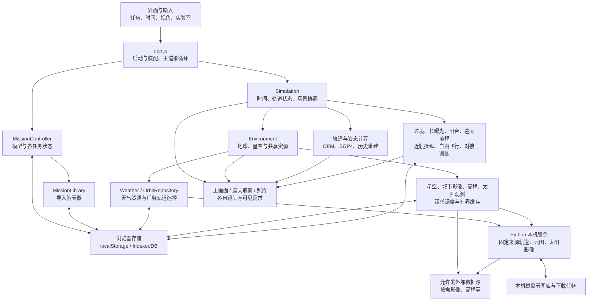

# 系统架构与状态边界

月面地名由 `lunar-place-catalog.js` 读取完整正式目录与着陆任务，`lunar-place-layout.js` 建立球面分桶索引，按视口、正背面、尺度和密度筛选。一张 Canvas2D 叠层承载全部标签并复用于 PNG 导出，避免创建数千个 DOM 节点；未知坐标的任务保留资料，不生成落点。`lunar-renderer.js` 按需加载经 Mollweide 反投影的 4096×2048 地质纹理，复用月固经纬、地形网格与 Canvas 标注；透明无数据像素显示中性灰色。地质图采用辅助照明并保留分类色，选择图层切至三维图鉴。`lunar-geology-viewer.js` 另外按需打开四幅离线原版图像，保留复合地图、图例与年代尺。四象与三垣的透明度经共享设置传递，仅影响总览 `symbols` 层。

适用版本：本地 v1.37。作者：Wenshuishi。核对日期：2026-11-08。

本页维护本地 v1.36 的实现关系与文档基线，解释修改软件时需要保留的关系和边界。具体能力见[产品范围](product-scope.md)，字段见[数据格式与本机接口](formats.md)，操作见[使用手册](../使用说明.md)，执行结果见[验证指南](verification.md)。这里的结构描述不代表本批已经完成运行验收。

赤道网与黄道作为共同天球参考层，由日期真赤道／真黄道旋转至现有 J2000 场景；主画面、巡天与照片、阳台使用同一数学定义。恒星距离按物理 HIP 身份查表，不随中西名称或语言变化。巡天打开时使用既有近景构图流程，之后不持续改变用户镜头。

宇宙探索馆作为实验室第六页签懒加载，共用既有模态生命周期与主循环暂停机制。独立相位驱动纯数学读数和 Three.js 视图；单一渲染器缓存五场景，暂停拖动／尺寸变化按需刷新，退出停止 RAF。真实天区交接通过现有巡天物理目录解析，不改变目录或主场景时刻。

月球观测作为第七页签复用实验室生命周期；地面视盘和自由三维月面共用 `lunar-math` 的月固坐标与 `lunar-renderer` 的真实位移网格。日照、月相和地名由同一经纬约定驱动；升落搜索只在显式计算时执行。地形 gzip 随构建内嵌或内容寻址，渲染器懒加载并独立释放。地面观测点复用已有 observer 存储；独立日期不修改主任务。巡天交接通过动态太阳系天体接口跟踪 Moon，沿用主时钟。

生日星空卡由 `birthday-calendar` 负责日期规则、`birthday-content` 负责40项文化内容及搜索别名、`birthday-card` 负责编辑和正反面预览。`birthday-card-render` 绘制正面，插画沿用现有注册网格，星点与连线使用同一相机投影。`birthday-sky-frame` 根据生日、时间和UTC偏移构造独立拍摄状态，未填时间采用明确显示的20:00；J2000星表与相机目标保持同一坐标基准，太阳系天体按独立拍摄时刻计算。

`birthday-card-back` 独立选取一个文化天区并绘制全幅明信片，所有标注仍使用主页星图代码。银河借用现有纹理或加载私有纹理；DSS建立私有SkyDetail，显式启用wideField，等待完整同源HiPS瓦片再捕获，释放私有纹理和缓存连接。普通主页／巡天保持原有18°影像策略。相机缩放、平移与滚转共同作用于影像、星位、连线及插画，不写回源配准。捕获继续复用skyOnly巡天渲染器并恢复共享renderer状态。

界面以输入代次和取消信号隔离异步结果，分别缓存正面和背面Blob；共同生日或落款改变时两面失效；正面与背面的独有控件仅使本面失效，单面PNG直接复用预览。`birthday-card-export` 将两张PNG写入标准STORE ZIP，含CRC32、UTF-8文件名和中央目录，一次下载成套图片；打包前固定两面结果，设置变更或关闭窗口后不触发旧下载。

## 天体观测台

`planetary-observatory.js` 管理入口、图层、观测地点、事件与双栏比较；`planetary-renderer.js` 复用主WebGL渲染器，在体固坐标中显示地球和火星。地球纹理及高程只借用既有环境资源；火星纹理按需加载并限制缓存。太阳和月球交接至既有观测窗口。`planetary-observation-math.js` 计算地面视线、光行时和体固照明，`planetary-events.js` 独立异步搜索事件。`satellite-ephemeris.js` 懒解压JPL子集，在母星相对J2000坐标求值，太阳系统一变换位置。

## 地表与太阳系主视图

`world-explorer.js` 由 `app.js` 安装，主帧在活动时交给世界视图，共用 renderer、canvas 和 `Simulation.time`；切换地面／太阳系释放旧视图，返回轨道恢复原控制器。地面以 `ground-world-math` 的WGS84/ENU导航和原始DEM取样为基础，`ground-world-input` 复用驾驶键位，按真实时间加减速并随离地高度调整速度。`ground-world-surface` 向主高程管理器申请接触样值并提供近地补片；`groundRenderPose` 将导航位置映射到主地球球面，`shared-world-earth` 以同一地表着色器绘制补片与完整地球，借用城市、高程、云、大气和极光。`ground-world-sky` 把当地视线转入共享星空层。太阳系使用独立 `solar-world` 场景与同历元几何星历，不将天空视位置当作行星物理位置。

`shared-world-sky` 统一主星表、银河、星图、插画和巡天细节消费者；主页及三个模式修改同一环境设置。地点、最多30个收藏、地面速度／朝向偏好与独立观察效果、视场位于 `starorbit-world-v1`，不会覆盖旧阳台观测点；首次无世界地点时可从旧观察者初始化。在线地名仅在显式搜索时请求 Photon。局部垂直基准及固定恒星目录的计算口径见[地表与太阳系](world-explorer.md)。

## 总体关系

图中的箭头表示主要调用或数据依赖，不表示所有模块都通过统一消息总线通信。当前实现使用 JavaScript 模块、共享对象、事件和直接方法调用；浏览器中的 `window.viewer` 主要用于运行诊断和浏览器测试，不是承诺兼容的扩展 API。

## 模块职责与修改入口

| 职责 | 当前主要源码 | 修改时需要一起考虑的关系 |
| --- | --- | --- |
| 启动、站体装配、主渲染循环 | `src/app.js`、`assembly.js`、`runtime-assets.js` | 模板模块、转轴、比例、启动恢复顺序；不能让首帧覆盖已保存翼角 |
| 轨道、时间与总体状态 | `simulation.js`、`orbit.js`、`gp-orbit.js`、`dfh1-history.js` | 有效期、坐标转换、历史与现代分支、事件求解和预报边界 |
| 任务注册与模型切换 | `missions.js`、`mission-controller.js`、`mission-package.js`、`mission-library.js` | 模型轴向、能力开关、轨道归属、镜头记忆及异步切换 |
| 姿态、受光和阴影 | `spacecraft-attitude.js`、`solar.js`、`spacecraft-lighting.js`、`spacecraft-shadow.js` | 地面轨迹定向与速度定向不同；受光读数不等于发电功率 |
| 公共环境和天体 | `environment.js`、`earth-shaders.js`、`atmosphere-*.js`、`moon.js`、`star-chart.js` | 多视图的时间、太阳方向、环境开关和地球自转应一致 |
| 资源获取和天气库 | `weather.js`、`orbit-repository.js`、`resource-fetch.js`、`resource-recovery.js`、`weather-cache.js`、`cloud-library.js` | 下载完成与实际使用是两个状态；重复请求、失败保留、缓存保护和任务隔离 |
| 高清星空、城市影像和高程 | `sky-detail*.js`、`city-terrain*.js`、`earth-elevation*.js` | 主画面/取景/照片的视野需求、共享请求、有界驻留、取消和关闭释放 |
| 太阳观测 | `solar-data.js`、`solar-cache.js`、`xuntian-solar-view.js` | 真实观测时间、波段、几何元数据、PNG 尺寸以及本机与网页能力差异 |
| 巡天取景和照片 | `xuntian-scope.js`、`xuntian-view-render.js`、`exposure-earth-fast.js`、`exposure-lab-render.js` | 相机光轴、景深精度、源数据状态、照片准备和署名 |
| 近轨操纵与独立训练 | `main-flight*.js`、`free-flight*.js`、`docking-*.js` | 主场景操纵、独立自由飞行、对接训练各有状态；键盘焦点和清空推力需共同回归 |
| 保存、场景和观测记录 | `session-memory.js`、`scene-format.js`、`scene-share.js`、`observation-store.js` | 当前网址的偏好、完整场景、观测配方和独立飞行存档用途不同 |
| 本机服务和分发 | `scripts/serve.py`、`build.mjs`、`scripts/package-portable.py`、`macos/Launcher.swift` | 服务工作根目录、构建方式、入口重定向、启动器引用和发布证据 |

源码路径均相对于源码仓库。便携包不包含完整源码；可查阅固定公开基线的 [app.js](https://github.com/Wenshuishi0528/StarOrbit/blob/5ed3d96b52db26f5e9500430eec3a67a32d14f35/src/app.js)、[Simulation](https://github.com/Wenshuishi0528/StarOrbit/blob/5ed3d96b52db26f5e9500430eec3a67a32d14f35/src/simulation.js)、[Environment](https://github.com/Wenshuishi0528/StarOrbit/blob/5ed3d96b52db26f5e9500430eec3a67a32d14f35/src/environment.js)。本地 v1.34 的星官数据、共享文化图层及控件以当前工作副本为准；上述固定公开链接仅对应其历史提交。

## 状态由谁拥有

| 状态 | 所有者及存放位置 | 重要边界 |
| --- | --- | --- |
| 当前时间、暂停、倍速、现实/自定义模式 | `Simulation`；会话偏好由 `session-memory.js` 保存到 localStorage | 现实模式重新打开采用当前时间；自定义模式恢复保存时刻 |
| 空间站组合及太阳翼角 | 主装配对象与 `tiangong-viewer-v3` | 只适用于已适配的装配模型；导入普通 GLB 不会自动获得太阳翼或自由飞行能力 |
| 当前任务、各任务姿态/自旋/镜头 | `MissionController`；`tiangong-missions-v1` | 切换任务不能把前一任务的轨道、惯性或镜头误写到后一任务 |
| 每个任务选择的轨道 | `OrbitRepository`；`tiangong-orbit-library-v1` 与资源库 | `null` 为内置选择，`'none'` 为显式无轨道，记录 ID 为某条下载/导入轨道；轨道正文还要验证任务和对象编号 |
| 地球、星图、地理、画质与显示偏好 | `Environment` 和相关设置模块；localStorage | 通常跨任务共享；导入场景/环境收藏可主动恢复对应设置 |
| 云图、极光、轨道快照及收藏 | `WeatherCache` 的 `tiangong-environment-data-v1` IndexedDB | 当前使用、收藏、任务选择和待应用记录受清理保护；达到预算仍可能保留受保护数据 |
| 用户导入模型包 | `MissionLibrary` 的 `tiangong-mission-packages-v1` IndexedDB | 配置、模型与初始轨道按任务保存；单个坏记录不能注册为可用任务 |
| 高清星空/城市/高程 | 各资源管理器、内存/GPU 和 IndexedDB 缓存 | 数据缓存与各窗口渲染对象分开管理；不承诺所有外部天区或城市都已离线保存 |
| 太阳观测 | `SolarObservations` 与 `starorbit-solar-observations-v1` IndexedDB | 每波段保存观测记录；用户太阳快照与通用天气快照格式不同 |
| 阳台、长曝光与巡天观测记录 | `starorbit-observations-v1` IndexedDB | 记录是观测配方与关联图像/轨道归档，不是完整软件备份 |
| 独立自由飞行 | 内存 `run/session/checkpoint`；`starorbit-free-flight-v1:<id>` localStorage | 每次飞行自带装配、参考轨道种子和检查点；普通场景文件不包含这些独立存档 |
| 对接训练 | `DockingRecorder` 的有界会话内记录 | JSON/CSV 是导出分析结果；会话内回放不等于支持从文件恢复训练 |
| 云图处理结果与下载任务 | Python 服务的磁盘库 | 可被多个本机端口共享；任务状态需按端口隔离；浏览器清理与磁盘清理不是同一操作 |

浏览器保存按 origin 隔离。`https://…`、`file://`、`http://127.0.0.1:8771`、`http://localhost:8771` 和不同端口可能看到不同数据。文件打开方式的持久化还受浏览器策略影响。内存降级只保证当前会话尽量可用，不能据此承诺刷新后恢复；导入模型要求持久缓存可用。

这些数据库名是维护诊断信息，不是面向用户的导入接口。跨设备优先使用界面支持的场景、快照和原始模型文件；完整浏览器数据备份需使用浏览器/系统层面的方式。

## 坐标、单位与模型边界

| 场合 | 约定 |
| --- | --- |
| 星历交换 | 地心 EME2000、UTC；位置 km，速度 km/s；JSON 时间为 Unix 毫秒 |
| GP/OMM 输入 | TEME、UTC、SGP4；应用转换成 EME2000 采样。UTC 近似 UT1，忽略极移；转换用于可视化 |
| 地球整体计算 | 球体半径 6371 km；轨道读数中的高度和经纬度是球面/地心值。可见高程网格没有替代飞行动力学的地球模型 |
| 装配近景 | 5 个查看器单位对应 1 m；地心场景以 km 工作，因此近景模型和地心对象不能直接共用未经转换的位置 |
| 默认空间站定向 | +X 沿地面轨迹、−Z 朝地；前向计入地球自转 |
| 通用独立卫星 | GLB 前向归一到星体 +Z，轨道法向归一到 +Y；参考方式取决于任务的姿态策略 |
| 对接训练动力学 | RTN：R 径向向外、T 沿轨、N 轨道法向；位置 m、速度 m/s、时间 s |
| 对接接口/近站场景 | X=T、Y=N、Z=R；接口 +X 向外。姿态四元数为 `[x,y,z,w]`；角度读数多用度，动力学角速度用 rad/s |
| 独立自由飞行参考 | 保存开始时的惯性位置/速度种子，近站运动采用旋转参考框架和固定步长；接触阈值是教学参数 |

修改数据格式或可视化时，要区分惯性坐标、地固坐标、轨道局部框架、接口框架和相机投影。照片中的“真实地形”表示按来源高程生成的网格，不表示具备真实着陆、碰撞或建筑物模型；受光百分比也不是工程功率预测。详细计算依据和来源见[素材说明](../素材与迁移说明.md)及[技术资料索引](README.md)。

## 启动与恢复顺序

`app.js` 的 `boot()` 先确保模型和内置轨道就绪，再恢复各层状态：

1. 建立 WebGL renderer、相机、鼠标控制、侧栏、语言和音乐；无法创建 WebGL 2 时显示启动失败提示。
2. 解压/取得空间站 GLB，同时装载内置轨道；解析模板模块，恢复装配、建立转轴和适配相机。
3. `missionLibrary.restore()` 读取导入模型和初始轨道，验证并注册有效任务。
4. 创建 `Simulation`、`Environment`、时间轴和小地图，创建 `MissionController`，恢复当前任务和相应轨道选择。
5. `installSessionMemory()` 在首个正式模拟帧前恢复自动追日、时间模式、镜头、面板和显示开关；等待环境/天气元数据就绪。
6. 安装场景交换、主导航球和近轨操纵，绘制首帧，隐藏加载层，设置 `document.body.dataset.ready='true'`。
7. 缓存天气纹理解码在随后任务中恢复；继续安装实验室、巡天、镜头目标、自由飞行、浮动窗口、帮助和访问统计。

`dataset.ready` 是首帧标志，不能单独证明所有浮动窗口和下载纹理均已完成安装。浏览器测试应等待目标模块/控件及其资源终态，避免仅用固定睡眠判断就绪。启动加载与高清天气解码分开，是为了避免某条缓存纹理阻塞整个软件。

## 切换与异步状态

数据变化会跨越 fetch、解码和存储事务。以下关系需要在维护中保留：

- **下载归属固定**：轨道下载开始时捕获任务 ID，完成后更新原任务，不能按完成时的当前任务写入。
- **选择和下载分开**：下载库可以出现较新记录，画面仍使用用户明确选择的历史记录。更新失败保留有效旧数据。
- **导入先校验**：任务配置、GLB 与轨道完成校验后才注册/保存；场景先经白名单验证，再逐步恢复各状态。
- **正在恢复时互斥**：任务切换、场景恢复、手动导入和缓存清理有相应 busy/版本检查；新增 await 后需要复核选择是否仍有效。
- **清理保护引用**：自动清理必须保护收藏、实际使用、所有任务所选轨道及下载/解码/待应用资源；删除持久记录和销毁正在显示的纹理不能混为一步。
- **输入及时清空**：失焦、切任务、进入输入框和退出操纵时应清空推力/转动输入，防止残留操纵。

新增功能需明确写明状态属于哪一层、何时保存、退出时释放什么，以及旧数据缺失时如何回退。相关验证入口见[验证指南](verification.md)。

## 主画面、巡天与照片如何共享

`Environment` 提供太阳方向、地球姿态、天气、星表、太阳观测及高清资源管理器。主画面和取景/照片使用这些数据提供者；各自仍拥有相机、渲染对象和可见需求，不意味着所有 WebGL 上下文只占一份 GPU 内存。

`xuntian-view-render.js` 为取景和照片建立不同 view ID，并把需求交给共享的星空/城市/高程管理器。预览按当前窗口尺寸请求；照片按输出尺寸准备，允许有限等待，并记录实际取得的数据状态。长曝光也会使用地球取景准备流程。缺覆盖、断网或超时应保留已有数据/较粗层级，并通过照片来源说明表达实际回退。

修改图片导出时应同时核查：视野与相机方向、地球遮挡、天空与地表的分辨率、太阳影像时刻、星名开关、数据署名以及任务结束后的资源释放。只验证主画面无法证明照片路径正确。

## 星空文化与教学图像

`sky-cultures.js` 将西方星座和中国星官作为同一星空上的数据提供者；`sky-culture-controls.js` 提供天区／星官导航、成员图和主画面／巡天定位。`skyCulture` 由 `star-chart-settings.js` 正规化，默认 `western`，与 UI 语言、星空影像来源独立。场景和环境收藏通过现有环境设置路径保存它；旧场景缺省恢复西方。

名称、成员和连线进入同一 `star-chart.js`、`sky-annotation-layout.js`、`star-label-catalog.js` 与巡天目录／准星路径。数据不能把所有成员压成 HIP：Gaia 恒星与星团对象保留独立标识。成员图和高亮使用同一目录的本体连线成员，不依赖某星官是否有插画；有名增星单独计数、支持搜索，不据此推造连线。切换只更新文化对象和相应选中状态，不能改变物理天体方向、时刻或强制执行跨体系群组映射。

中国文化数据与现代图像分别位于 `assets/chinese-sky/` 和 `assets/chinese-sky/art/`。`ConstellationArt` 接受多个文化的 manifest，纹理键带文化命名空间，按视野请求、共享有界驻留与取消；当前代码的图像 GPU 预算为 16 MiB，不能把中西全部图片同时常驻。`ConstellationArtLayer` 按天球配准、遮挡与视场淡出，照片沿用当前体系及实际图像署名。四象是天球意象，不是固定屏幕方位；三垣和宿区不能复用西方 IAU 边界。

修改时同时核查体系切换、语言切换、搜索／准星、无插画成员图、旧场景和收藏恢复、各视图释放及照片。来源和历史基线见[中国星官数据](../assets/chinese-sky/README.md)，图像归属见[教学意象说明](../assets/chinese-sky/art/README.md)。

## 本机服务与外部边界

`scripts/serve.py` 绑定 `127.0.0.1`，默认端口 8771。它既提供静态资源，也处理限定来源的轨道、云图、太阳影像和用户主动开启的设备方向流。接口不接受任意目标 URL；网页构建的相关功能门控由 `__WEB_BUILD__` 决定。具体路由见[接口参考](formats.md#本机-http-接口)。

当运行根目录存在 `dist-local/index.html` 时，请求 `/` 或 `/StarOrbit.html` 实际返回轻量入口，相应 `/assets/` 优先使用 `dist-local/assets/`。这是保留用户原访问地址和数据的服务端映射，不是把内置资源改成在线依赖。

`/api/status` 仅返回应用标识 `tiangong-earth-viewer`，不包含运行版本或根目录。启动器可能复用已运行服务，所以服务探测成功后仍需核对页面版本和实际脚本。替换 Python 服务源码后必须重启对应进程，刷新页面本身不会重载服务代码。

## 三种构建与安装

| 构建 | 入口/资源 | 运行与限制 |
| --- | --- | --- |
| 便携单文件 | `StarOrbit.html` | 内嵌随软件提供的资源；可直接打开。外部按需数据没有因此全部离线；本机处理接口需要服务 |
| 本机拆分 | `dist-local/index.html`、哈希资源、`version.json` | `serve.py` 在原 `/StarOrbit.html` 地址映射，适合日常本机运行；构建保留本机接口能力 |
| 网页静态 | `dist/index.html`、哈希资源、`version.json` | 部署静态目录；不含 Python 服务，受限更新通过文件导入等方式完成 |

`npm run build` 先生成便携单文件再生成本机拆分版；`build:web` 单独生成网页版。单文件和拆分版来自同一源码与版本元数据；哈希资源名帮助识别缓存和验证产物，但不能替代实际部署核对。

macOS `.app` 是本机服务与浏览器的启动器。安装版 `launcher-config.json` 可指向独立运行根目录；便携启动器用 `root: "."` 引用其旁边的运行文件。源码仓库、安装目录、下载解压目录和正在运行的服务可能不同，发布/迁移步骤见[开发与发布维护](development-release.md)。

## 修改后的核查边界

本页依赖于任务能力、状态归属、格式版本和构建方式。当修改这些边界时，同批更新本页、相应格式说明、使用手册和[产品范围](product-scope.md)，在[验证记录](verification.md)中记录实际执行范围。历史 `v*-details.md` 保留对应版本的设计与证据，不能自动视作当前完整架构或本次验收结果。

## 星际空间

世界视图统一管理星际、太阳系与地表的渲染器所有权和生命周期。`interstellar-catalog.js`首次进入时将共享星表与可靠视差表连接为不可变TypedArray；中西连线引用同一颗HIP恒星。`interstellar-math.js`维护日心J2000光年坐标、光度距离换算和按墙钟积分的加减速。`interstellar-world.js`以高低位拆分坐标在GPU计算相对星位，一次Points绘制恒星，不逐帧重建星表；标签使用有限DOM池；全体系可用连线合并绘制，选中星图单独高亮。太阳邻域与太阳附近参考视角调用共享星空层，真实空间航行用三维坐标投影成员和连线。`interstellar-solar.js`复用太阳系星历、共享地球渲染器和已加载月球纹理。

离开视图销毁几何、材质和输入监听，保留1.23MB共享空间数组及浏览器航点；银河纹理借用现有资源，不转移所有权。大型Gaia分块目录没有在本版引入。[数据和约束](interstellar.md)。

## 地表流式资源与统一环境

`surface-streaming-controls.js` 维护主环境中的自动影像开关、影像和高程半径，同一控件挂载到城市数据面板与世界地球面板。`surface-streaming-plan.js` 按视锥选择地理区域，`CityTerrain` 复用既有工作线程、瓦片缓存和纹理图集；移动后的需求更新取消不再需要的任务，缓存内容继续服务主页地球。高程数据和显示网格分别设预算，近、中、远采样环交错加载；接触精度按离地高度而非海拔确定。区域网格异步替换期间保留旧网格，避免数据更新造成空洞。

缓存清理先取消当前请求并推进代次，清理后的当前区域暂停自动下载；位置或视野发生明显变化、或用户点击继续后恢复。影像清理不删除手动离线城市包。`ground-location-map.js` 只借用当前底图和图集绘制位置、朝向、地名及比例尺，不新建缓存。

共享云层保留同一纹理和天气参数，根据观察者位于云球内外选择可见面，并在云着色中只计算观察者至云的空气路径。夜景年份由同一环境设置控制，2025 AVIF分块资源延迟加载，2024和2016仍可选。

## 地球科学图层

`earthObservation`与既有地球资源一起由环境资产目录管理。天体观测复用同一渲染器、体固坐标和相机；普通底图借用主页纹理，科学栅格使用独立日期与无曝光色标。矿点目录按需解压，按尺度聚合为单个Points绘制对象，最多缓存三个聚合结果，关闭观测释放几何与材质。[来源与处理](../assets/earth/observation/README.md)。
