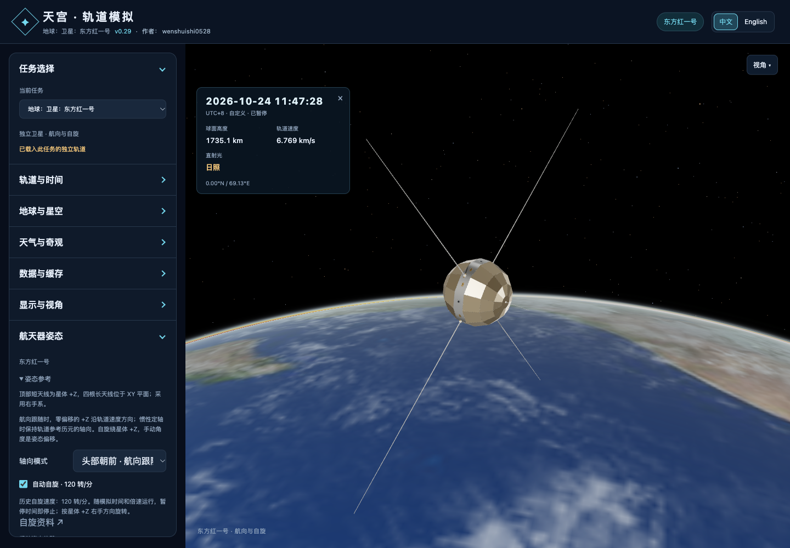

# v0.29 多任务框架与东方红一号

## 使用入口

左栏顶部的任务选择统一按“星球：类别：名称”命名：**地球：空间站：中国空间站**、**地球：卫星：东方红一号**。`planet`、`category`、`name` 是独立配置字段，名称由 `missionLabel()` 生成，中英文共用这一规则。每个任务保存模型、轨道记录、姿态策略及镜头；模拟时刻共用。空间站保留舱体装配和太阳翼追日，左栏下方共用“航天器姿态”模块：按任务显示轴向说明，东方红一号提供航向／惯性定轴、自动自旋和手动角度偏移。缺轨道或时刻越界时保留模型查看，清空位置读数和轨迹，并提供跳回有效时刻的按钮。

场景文件使用 `tiangong-scene-2`，携带任务 ID、手动姿态和可空的轨道；旧 `tiangong-scene-1` 文件按中国空间站恢复。旧空间站组合、环境及缓存继续兼容。显式无轨道状态可跨任务切换和刷新保持。环境与时间共用，切换不会把一颗卫星的轨道或相机套给另一颗。

## 东方红一号数据

原始输入：[`dfh1-gp.json`](../assets/spacecraft/dfh1-gp.json)。源站：[CelesTrak GP JSON](https://celestrak.org/NORAD/elements/gp.php?CATNR=4382&FORMAT=JSON)。本批访问源站及固定本地中继得到同一份根数。

| 字段 | 数值 |
|---|---|
| 对象 | DFH 1 / NORAD 4382 / 1970-034A |
| 根数历元（UTC） | 2026-10-24T03:47:28.325472 |
| 倾角 | 68.4245° |
| 偏心率 | 0.10314617 |
| 平均运动 | 13.14681991 圈/日 |
| 升交点赤经 | 158.5636° |
| 近地点幅角 | 224.0933° |
| 平近点角 | 127.328° |
| 传播 | satellite.js 6.0.2，SGP4 |
| 展示窗口 | 2026-10-21 03:47:28.325 至 2026-10-27 03:47:28.325 UTC |

这些是该历元的平均根数，不是 1970 年发射轨道参数。SGP4 每 60 秒生成一个 EME2000 位置／速度样本，共 8,641 个；样本之间沿用八点局部 Lagrange 插值（位置、速度六分量分别插值）。±3 天是本应用的保守展示政策，不是实际轨道误差保证。源站更新会改变历元和窗口。界面同时显示根数历元、与模拟时刻的时间差；更新失败保留旧数据。

GP 默认为地心、TEME、UTC、SGP4，显式提供其它参考系时拒绝；核对 NORAD 和国际编号。TEME 先按 GMST82 转 PEF，再用现有 Astronomy Engine 的地球轴（GAST、岁差与章动）转 EQJ/EME2000，速度含旋转矩阵的时间导数。UTC 近似 UT1，省略极移；JavaScript 日期分辨率为毫秒。这是可视化精度的坐标转换。

参考：[CelesTrak GP 格式说明](https://celestrak.org/NORAD/documentation/gp-data-formats.php)、[Vallado 等 SGP4 参考论文](https://celestrak.org/publications/AIAA/2006-6753/AIAA-2006-6753.pdf)、[satellite.js](https://github.com/shashwatak/satellite-js)、[Skyfield 卫星接口](https://rhodesmill.org/skyfield/api-satellites.html)。

## 比例与姿态

采用作者已有 `dongfanghong1_v03_meters.glb`。原始文件 2,833,072 字节，119 个网格、49,848 个三角形。GLB 按真实米制、Y-up 导出；打印模型的 1:50 不参与软件缩放。载入后绕 X 轴 +90°，每米转换成 5 个查看器单位，与原空间站一致；投影至轨道场景时除以 5,000 转 km。

几何归一化与任务姿态分层：原模型的顶部短天线成为星体 +Z，四根长天线位于 XY 平面；外层姿态为 `Rz(yaw) Ry(pitch) Rx(roll)`。默认“头部朝前 · 航向跟随”：零偏移时 +Z 沿 EME2000 轨道速度，+Y 为位置×速度的轨道法向，+X = +Y×+Z，采用右手系。另可选“惯性定轴”，以当前轨道根数历元（无历元则用星历中点）的速度基底作为固定示意轴。旋转模型会同时改变实际表面法线和照明，镜头旋转不会改变星体姿态。中国空间站仍使用地面轨迹定向，东方红一号的前向为顶部短天线，使用惯性轨道速度而非地面轨迹速度。“地平线”视角按当前轨道径向和任务参考系计算。

手动角度是相对基底的姿态偏移，归零恢复所选基底，航向跟随模式下头部朝前。

历史自旋速度依据袁利、姜甜甜、魏春岭、杨孟飞《空间控制技术发展与展望》，《自动化学报》2023 年 49(3):476–493，第 1.1.1 节：东方红一号采用单自旋开环稳定，转速 **120 r/min**，轴在惯性空间具有定轴性。[期刊原文](https://www.aas.net.cn/cn/article/doi/10.16383/j.aas.c220792) / [原文 PDF](https://www.aas.net.cn/cn/article/pdf/preview/10.16383/j.aas.c220792.pdf)。

自旋默认开启，绕偏移后的星体 +Z，以 `manualZYX × spinZ` 实现；120 转/分对应每秒两转、0.5 秒一圈。相位依模拟时刻求值，时间暂停时停止，倍速与时间跳转同步；开关保留当前相位，不带动观察镜头。高速播放的逐帧采样可能出现视觉混叠，并未把历史转速降成观赏速度。场景、预设、切换及刷新保存模式、开关、相位与时间锚点。

航向跟随模式中，顶部轴随速度方向更新；惯性定轴模式中，轴保持轨道参考历元的方向。自旋参数采用 1970 年的标称速度，初始相位从零开始，按星体 +Z 的右手方向旋转。原模型中的估计细节保留。原 Blender／打印交付文件未修改。

## 后续接入任务

- `src/missions.js` 的 `SPACECRAFT` 定义模型路径、源坐标上轴、每源单位多少米、`axes` 轴向说明和功能能力；`MISSIONS` 定义任务 ID、航天器引用、地心轨道文件、姿态策略、`attitudeNote` 参考说明及可选的 `spinRpm` / `spinSource`。
- `build.mjs` 按注册表内嵌模型和轨道表。`orbitAsset:null` 可先接模型；有轨道时指向合规 JSON。普通独立卫星使用 `assembly:false, solarArrays:false, manualAttitude:true`，按源文件填写 Y/Z-up 和比例。
- `MissionController` 负责惰性加载、可见性、功能控件、姿态和镜头记忆。多个任务可复用同一模型定义。当前的装配和太阳翼实现属于中国空间站；新型可动机构需添加适配器，不能只把能力设为 true。
- 轨道提供者与模型无关：通用 OEM／星历 JSON 为地心 EME2000、UTC、km/km/s；GP 需配置对象编号并经过 SGP4 转换。新增在线来源时，还需在 `Weather.updateAll` 和 `scripts/serve.py` 的固定白名单中增加对应适配，不能直接复用 DFH 1 的固定 URL。仅使用内置／导入轨道时 `updateSource:null`。
- 公共“航天器姿态”模块位于左栏显示设置之后、场景分享之前，中国空间站也显示自己的轴向与定向说明。轴向文案、自旋转速和资料链接均从注册表读取；新增任务补中英文文案，并核对自身的 +Z 极轴／前向归一化，不能照搬另一模型。
- `bindOrbit` 校验任务归属、中心天体和已知对象编号；无对象编号的通用星历由导入者核对后绑定到当前任务。下载开始时捕获任务 ID，完成后只更新原任务。缓存选择 `null` 表示内置、`'none'` 表示显式无轨道、字符串 ID 表示下载／导入记录。
- 自动清理保护所有任务选中的轨道及收藏；异步缓存读取发生选择变化时重新读取。切换／场景／收藏恢复加锁，启动完成恢复后才运行追日，避免覆盖手动翼角。

目前支持绕地任务；月球／深空任务仍需中心天体、传播器、背景、尺度和坐标转换适配。界面中望月是观测视角，不等于已有绕月任务引擎。

## 共用鼠标控制

`src/camera-controls.js` 是全部跟随／总览相机的唯一 OrbitControls 创建入口。Three.js r180 在构造时缓存 camera.up 到 `_quat` / `_quatInverse`，此前地平线／恢复镜头变更 up 后，该缓存未更新会让左键横拖偏离预期旋转轴。公共包装在每次 update 前同步变化，并清除旧旋转／平移惯性。模型加载不再创建专用鼠标逻辑；后续模型、姿态模式和场景恢复共用这一修复。依赖升级时必须保留相机轴回归，因为这段适配使用了 r180 内部字段。

## 验证与复现

`npm test` 执行完整既有测试和新增 `tests/missions.mjs`。新增测试检查任务隔离、轨道中心与对象编号、无数据／越界、GP 带／不带 Z 的 UTC 历元、实际 GLB 的极轴／四天线平面、三个 90° 旋转及组合旋转，还检查多时刻的实际模型极轴沿速度方向、120 rpm 相位、冻结／继续、惯性基底以及多种 camera.up 的拖动保持性。

独立参考使用 Python **Skyfield 1.55** 与 Python sgp4，采用其自有 GP 初始化及 TEME → ICRS 转换，再通过 `ICRS_to_J2000` 转为同一基准；参考固定保存在 `tests/reference/dfh1-skyfield.json`。历元前后各三天内 9 个样本：最大位置差 **5.10 m**，最大速度差 **0.00972 m/s**；60 秒采样间 28 个插值核对点最大位置差 **0.220 m**。这些数值衡量两套实现及插值计算的一致性。

重建离线星历：`node scripts/prepare-dfh1-orbit.mjs`。可选独立参考重建：安装 `skyfield==1.55` 后运行 `python3 scripts/prepare-dfh1-reference.py`；使用内置时间表，不下载 JPL 行星文件。正常构建与运行不需要 Python Skyfield。

浏览器回归脚本：`tests/browser/missions.js`（在完整页面中执行）、`tests/browser/missions-reload.js`、`tests/browser/missions-spin-controls.js` 与 `tests/browser/missions-offline.js`（Playwright CLI 的 async page 函数）。覆盖任务／姿态／镜头、缺失和过期轨道、旧场景、文件导入导出、刷新和手动翼角、Moon 返回状态、并发切换、缓存竞态、预设锁与着色器编译。另通过实际左键指针拖动检查两种模型、地平线和返回任务的旋转中心、距离与极角，验证自旋开关／暂停／速度／镜头独立、中英文、通用姿态面板、窄屏、离线 HTML 和固定轨道中继。具体执行结果及文件哈希见 [验证记录](v0.29-validation.json)。

Subagent 只读审查发现并复核修复了收藏恢复竞态、启动手动翼角覆盖、轨道表硬编码、无轨道持久化、异步缓存标识不一致及非当前任务的缓存保护问题。最终审查没有遗留高优先级问题。
