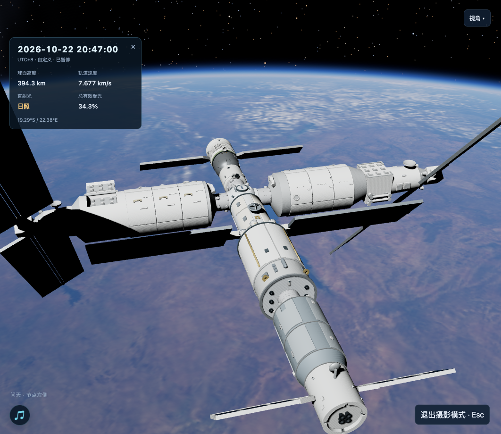
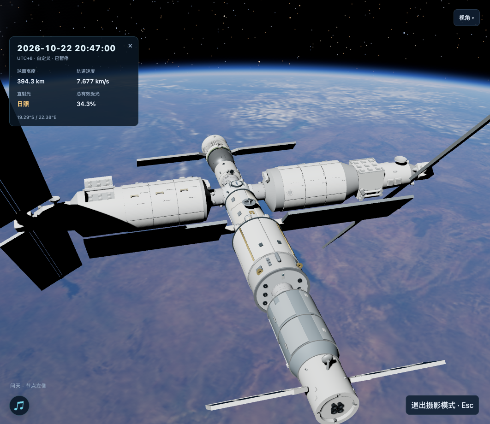

# v0.34 · 平滑阴影与计算优化

## 修复内容

中国空间站端面、箱体侧面与圆柱舱体的密集横纹来自阴影贴图的自遮挡误差。原先所有模型共用固定的 `normalBias = 0.08`，没有对应到当前阴影图的实际像素尺寸；在空间站这样的较大模型和斜射阳光下，相邻像素交替误判为阴影。

通用 `spacecraft-shadow.js` 根据可见模型包围盒和阴影分辨率计算偏移。法线偏移取 2.5 个阴影纹素，深度偏移取 1 个纹素对应的深度值。灯光距离和阴影相机范围同时适配模型尺寸，隐藏模型不参与覆盖范围。保留一张 4096 × 4096 阴影图及既有 PCFSoft 过滤，应用于中国空间站、东方红一号及后续导入航天器。

软件统一使用这一优化实现，界面保持现有操作。背景和航天器分层之间的深度清除显式启用深度写入，确保复用阴影时模型仍正确覆盖背景。

## 计算复用

- 时间暂停且物体静止时复用阴影图，旋转或移动观察镜头也复用。
- 比较太阳光方向，累计变化超过约四分之一阴影纹素时刷新。比较模型根节点和太阳翼关节的变换，发生运动时立即刷新。
- 模型切换、组合变更与手动姿态调整重新适配范围；自旋和自动追日继续随运动更新。
- 全影中跳过无直射光的阴影绘制；恢复日照时按当前姿态和太阳方向更新。
- 暂停期间复用太阳翼遮挡计算结果；手动调整翼角后刷新受光读数。运行时沿用原有求解节奏。

## 验证

所有主要外观检查均使用**最高画质、轨道阳光区、辅助照明关闭**，检查日照条件与太阳方向的一致性。空间站检查时刻为 UTC+8 2026-10-22 20:47 及 21:02，后者为斜射阳光；东方红一号也在全日照条件下检查。

同一时刻、同一镜头的空间站修复对照：

| 原固定偏移 | 按阴影纹素适配 |
|---|---|
|  |  |

GPU 回归使用双面接收面、独立遮挡物、两个模型比例和三个真实日照方向，共六组。较大比例下，无遮挡表面的平均通道误差由约 18–41 降至 0；三个方向的真实阴影像素数量分别为 1065、350、6514，修复后全部保留。

实际软件的刷新检查结果：

| 场景 | 阴影绘制次数 |
|---|---|
| 静止场景，原逐帧更新，20 帧 | 20 |
| 静止场景，缓存更新，20 帧 | 0 |
| 仅移动镜头，12 帧 | 0 |
| 固定翼角、缓慢太阳运动，30 帧 | 2 |
| 东方红一号自旋，12 个变化帧 | 12 |
| 全影自旋，8 帧 | 0 |

静止模型的缓存帧与重绘帧像素一致。以上数字统计阴影绘制次数；整幅画面仍继续渲染地球、星空和航天器。

通过 `npm test`，以及实际软件中的辅助照明、四档地影、显示像素比、HDR 抗锯齿、纯模型查看和 GPU 着色器回归。详细数据见 [验证记录](v0.34-validation.json)。测试代码为 `tests/spacecraft-shadow.mjs`、`tests/browser/shadows.js`、`tests/browser/shadow-cache.js` 和 `tests/browser/rendering.js`。

实现参考当前依赖 Three.js r180 的源码及官方 [LightShadow 文档](https://threejs.org/docs/pages/LightShadow.html)。
