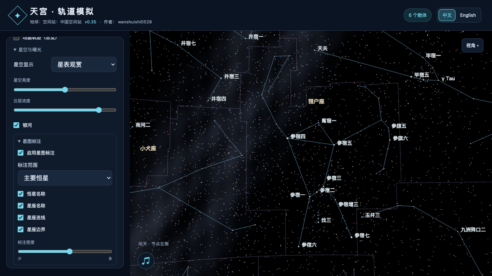
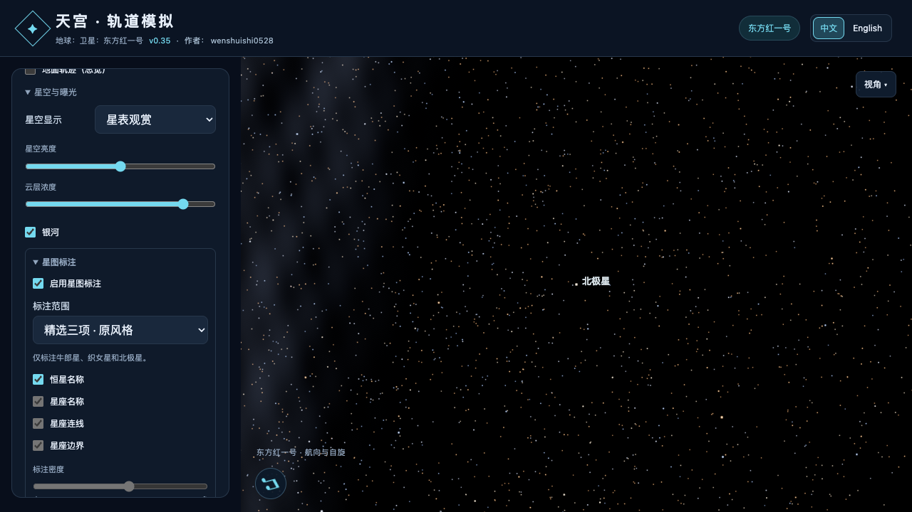

# v0.35 · 公共星图标注

进入 **地球与星空 → 星空与曝光 → 星图标注**。三级折叠面板收起时占一行，开启后显示星名、星座及密度设置。首次默认关闭；开启后默认主要恒星、星座名称与连线，边界关闭。

## 范围与预设

- **主要恒星**：361 颗，覆盖 3 等及更亮恒星，以及有专名的星座轮廓星。
- **全部已收录星名**：965 条，其中 541 条有专名，其余为组成星座轮廓的标准恒星标识。
- **精选三项 · 原风格**：牛郎星、织女星、北极星（HIP 11767 / Polaris）；此预设只显示这三项，关闭星座叠加。
- **88 星座**：名称、连线、边界分别控制。蛇座保留两片天区与两个名称位置。

中文界面使用常用中文名，英文界面使用英文／国际名称；标准标识保留原有 Bayer 等名称。恒星名为浅蓝白色，星座名为浅金色。标注使用稳定屏幕字号，亮星优先，并尝试多个位置避免重叠。名称数量和间距由密度控制，单屏上限 96 条，超出视野及被遮挡的名称隐藏。

实际界面：

## 通用性与资源

星图属于公共环境，所有航天器使用同一数据、字图和偏好；模型切换不重建星图。设置随本地偏好、环境收藏和场景分享保存。原版 `starLabels` 开关迁移到精选三项，旧场景补全新设置；侧栏展开状态改用稳定键，兼容旧位置数组。

首次启用时创建线段与文字资源。中文共用一张 1024 × 1024 字图，约 4 MiB；英文使用 512 × 512，切换语言释放旧字图。恒星名与星座名合并绘制，星座连线及边界各合并一次，全部打开最多增加 3 次绘制。

GPU 随相机更新投影，CPU 可见性和避让排版最多每秒 5 次；静止视角复用排版及文字缓冲，设置变化即时生效。关闭功能时停止相关更新。地球与月球以球面遮挡判断，航天器采用包围盒粗筛后对可显示名称进行几何查询；复杂静态网格首次命中时惰性建立 BVH，后续复用。

## 数据与坐标

名称及星座图案沿用 d3-celestial / XHIP，通过 HIP 编号与现有 41,411 颗星点关联。数据固定到 d3 commit `7e720a3de062059d4c5400a379146a601d9010e0`，保留 BSD 许可。

边界取自 **Davenhall & Leggett (1989), CDS / VizieR VI/49** 的官方 J2000 加密坐标，包含 2024 年 CEP/UMI 极区修订。原始等赤纬边界属于小圆；采用发布的约 1° 采样，避免只连接端点造成的极区偏差。输出共 782 条路径、9,918 点。来源及哈希存于 `assets/star-chart.json`，生成脚本为 `scripts/prepare-star-chart.py`，运行时无需下载。

## 验证与审查

- 数据测试：HIP 与现有星表坐标一致、全部 3 等亮星覆盖、常用中英文名称对应、88 星座、蛇座分片、跨赤经接缝及南北极边界。
- 浏览器：主要／全部／精选三项切换，星座开关、名称避让、中英文、关闭更新、跨任务复用、场景往返和偏好保存；首次启动及旧版本迁移另行检查。
- 性能：实际静止画面 30 帧内排版与文字上传均为 0 次；全部叠加增加 3 次绘制；字图与单屏名称数量受预算约束。
- 子代理独立审查发现并推动修复两项问题：极区边界大圆连接误差、复杂导入模型缺少遮挡查询加速。修复后复审和相关独立测试通过。

完整结果见 [验证记录](v0.35-validation.json)。
