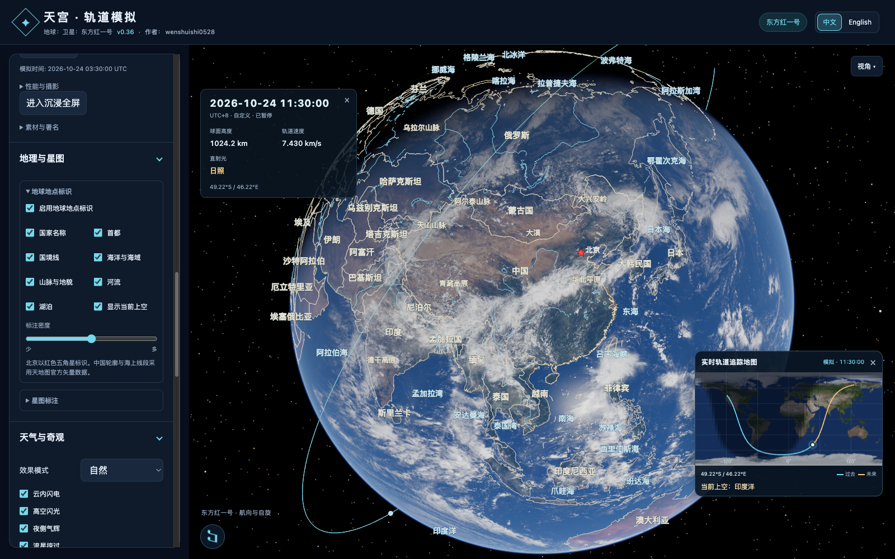

# v0.36 · 地理与星图

一级菜单 **地理与星图** 包含 **地球地点标识** 与 **星图标注** 两个二级面板。星图的主要／全部星名、88 星座及牛郎星／织女星／北极星精选模式保留，折叠状态继续使用原有稳定键。

## 地球地点标识

国家名称、首都、国境线、海洋与海域、山脉与地貌、河流、湖泊分别开关，共用密度滑块。首次总开关关闭，分类默认选中、密度 0.5。北京为红色五角星，其他首都为圆点；北京优先参与排版。

离线库包含 239 个国家与地区区域、199 个首都点位、118 个海洋与海域标注、292 个山脉／地貌／山峰标注、56 组主要河流名称及 275 个湖泊标注，共 1,179 条。单屏根据重要性、地球投影大小、类别和密度选取；文字朝向屏幕、锚点随地球自转。名称自动避让，也避让轨道信息框与小地图。背面、地平线以下和被航天器挡住的标签隐藏。图形层不接收鼠标事件，沿用原有拖动与缩放。

右下角 **当前上空** 使用航天器的星下点经纬度判断。陆地显示国家及主要地貌，海上显示海域；距首都 80 千米以内补充“某地附近”。转动镜头只改变画面标注，位置识别继续跟随航天器。开关随小地图所在面板显示；“显示当前上空”也可独立关闭。

## 中国边界与数据来源

中国数据直接取自国家基础地理信息中心 **[天地图行政区划公开浏览页](https://cloudcenter.tianditu.gov.cn/administrativeDivision)** 所使用的公开矢量响应：

`https://cloudcenter.tianditu.gov.cn/api/portal/region/map?gb=156000000&level=2`

2026-10-26 的原始响应保存在 `assets/geography/china-tianditu-20261026.bin.gz`。按官方页面公开的传输格式解码，合并 34 个省级区域得到国家轮廓，去除省际边线，保留台湾、海南及海岛几何。代码 156970000 的线段保留断续表示，156990000 的海上线段保持原有独立段落。数据来源与 SHA-256 写入 `assets/geography/atlas.json`。

全球数据采用 **[Natural Earth v5.1.2](https://github.com/nvkelso/natural-earth-vector/tree/v5.1.2)**：国家／首都为 1:50m 数据，自然地理采用 1:50m 区域、水域、河湖及 1:10m 山峰点。数据使用其[公有领域条款](https://www.naturalearthdata.com/about/terms-of-use/)。中国区域替换为上述官方矢量；邻近的重复全球边线在预处理时移除。运行时位置识别优先使用官方中国区域。

中文地名采用数据集多语言字段、常用地名校对与河流中文对照，预处理使用 OpenCC 统一简体字；英文界面采用英语名称。生成脚本 `scripts/prepare-geography.py` 的依赖见 `scripts/geography-requirements.txt`，可用 `--cache` 指定已下载的 Natural Earth 源目录。所有源文件均记录 URL 与内容哈希。软件运行时使用内置 atlas，无需地图密钥、GIS 运行库或联网取图。

## 计算与资源

- 地理数据与设置归公共环境所有，切换模型沿用同一实例；环境收藏、场景导入导出、本地记忆统一保存。
- 首次启用才创建 GPU 资源；文字与首都符号合并一批，国界／中国轮廓／海上线段／河流／湖泊各一批，最多 6 次绘制。
- 中文字图 1024 × 1024，约 4 MiB；英文字图 512 × 512，约 1 MiB，切换语言释放旧字图。单屏上限 96 条名称，默认密度上限 57 条；实际数量由遮挡与避让决定。
- 预生成粗／细两档线数据，屏幕尺度切换具有滞回区间；球面加密避免长直线穿入地球。全部精细线层约 11 万顶点。
- GPU 随每帧相机和地球姿态投影；CPU 排版最多每秒 5 次，静止画面复用排版及上传缓冲。位置查询采用 10° 网格索引，最多每秒约 2.9 次，暂停后相同位置复用结果。
- 航天器遮挡查询复用现有包围盒与静态网格 BVH。关闭功能停止相关排版、位置查询和绘制。

## 验证

数据测试覆盖坐标轴、日期变更线、区域孔洞、官方源文件哈希、北京红星属性、台湾／香港／澳门／西藏等区域归属、北京附近和海域识别、旧场景默认值及非法设置。浏览器检查菜单层级、名称避让、地球遮挡、分类开关、中英文、模型切换、场景／收藏恢复与重开记忆，并回归原有星图和小地图拖动行为。

验证记录与实际画面见 [v0.36-validation.json](v0.36-validation.json)、[地理标注画面](v0.36-geography.png)。

本机精细档中国总览视角，30 次 CPU 排版采样平均约 1.45 毫秒，最大约 2.1 毫秒；暂停静止画面后排版、文字上传与位置查询均保持 0 次重复更新。实际检查通过 24 项地理功能、3 项保存恢复、23 项星图回归与 33 项小地图拖动检查。

