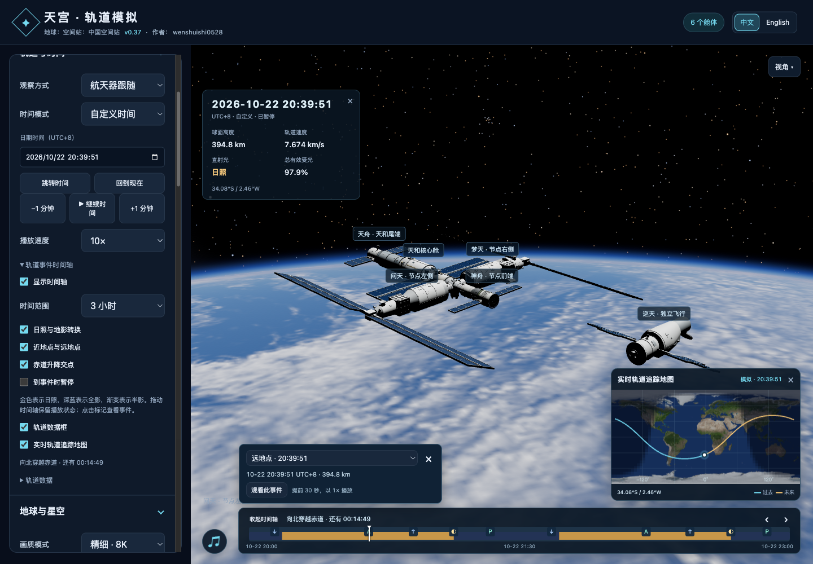

# v0.37 · 轨道事件时间轴

所有航天器共用底部时间轴和左栏“轨道与时间 → 轨道事件时间轴”。默认显示三小时，支持十二／二十四小时与紧凑折叠；时间统一为 UTC+8。时间窗口分段前移，拖动时保持固定。事件标记支持鼠标、键盘及详情下拉选择，邻近事件合并显示。

## 事件与操作

日照与地影有四个接触时刻：开始进入地影、进入全影、开始离开全影、恢复完全日照；金色／深蓝色带表示日照／全影，渐变表示半影。近地点、远地点附高度；赤道交点区分向北和向南。

拖动和点击事件保留原播放状态与倍速；现实时间定位后以 1× 从选中时刻继续。观看事件从提前三十秒处开始，以 1× 播放。可选“到事件时暂停”默认关闭：开启后按筛选类别在下一事件精确停时，高倍速也停在第一个跨越事件；计算尚未覆盖的区间先等待结果。继续播放不会在同一事件重复暂停。

关闭时间轴保留侧栏下一事件读数。摄影模式与沉浸隐藏界面时同步隐藏时间轴；地理标签避让时间轴与详情卡。音乐圆形按钮保留原位置。

## 计算与存储

- 使用当前任务现有八点轨道插值；太阳与日期极轴按五分钟节点插值并在一次扫描中复用。赤道交点使用与地面经纬度相同的日期极轴。
- 每六十秒粗采样，只对候选根细化到 250 毫秒区间。地影角距离谷值单独细化，涵盖短暂掠影及窗口首尾；太阳和地球的视圆盘决定半影／全影接触。
- 近远地点先用径向速度寻找候选，再用插值位置的半径细化高度极值。高度振幅小于 100 米的近圆轨道不显示近远地点；退化赤道轨道不生成数值噪声交点。
- 一个有界内存缓存覆盖当前窗口及前后余量。暂停或只移动镜头时复用；时间窗口超出缓存范围或更换轨道时重算。计算约每四毫秒让出主线程，切换任务立即取消旧任务。倒计时与游标每秒最多更新四次，拖动直接更新游标。
- 没有新增外部数据、纹理、轨道库或网络请求。显示偏好保存到 `tiangong-timeline-v1`，事件数组不保存到本地存储。

本机 Node 验证中，三小时窗口约 16 个事件、结果序列化约 1 KB；二十四小时约 125 个事件、约 7 KB，扫描约 4–6 毫秒。实际窗口额外缓存前后余量；计算耗时随设备与轨道变化。完整单文件运行包维持约 235 MB，比 v0.36 增加 19,045 字节。

## 验证

- 数值测试：现有轨道四接触与逐时太阳位置对照，赤道交点方向、近远地点高度；解析开普勒轨道的极值时间，圆轨道／赤道轨道退化、持续日照、短掠影及窗口／数据边缘。
- 缓存测试：重复请求复用、取消、换轨道旧结果丢弃。全项目 `npm test`。
- 浏览器：两个内置航天器拖动与暂停／倍速、实时转自定义、取消指针、事件定位与观看、1×／1000× 自动暂停、筛选、24 小时、折叠、隐藏、偏好保存、无轨道与任务切换、语言、摄影模式及旧小地图拖动回归。
- 独立 subagent 审查：修复跨帧自动暂停的容差死区、实时暂停后的倍速、窗口边缘短掠影和底部说明的 CSS 优先级冲突。

验证记录：[v0.37-validation.json](v0.37-validation.json)。

